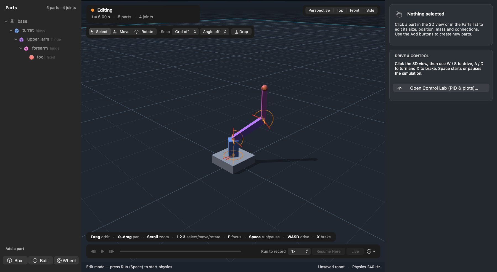
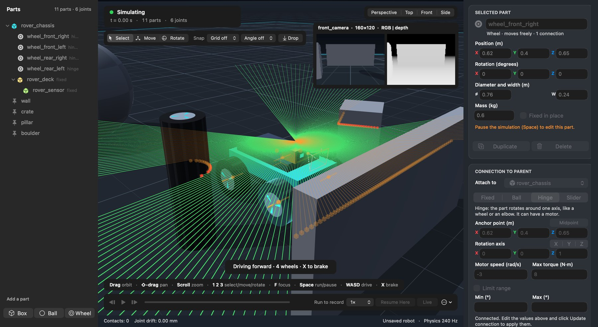
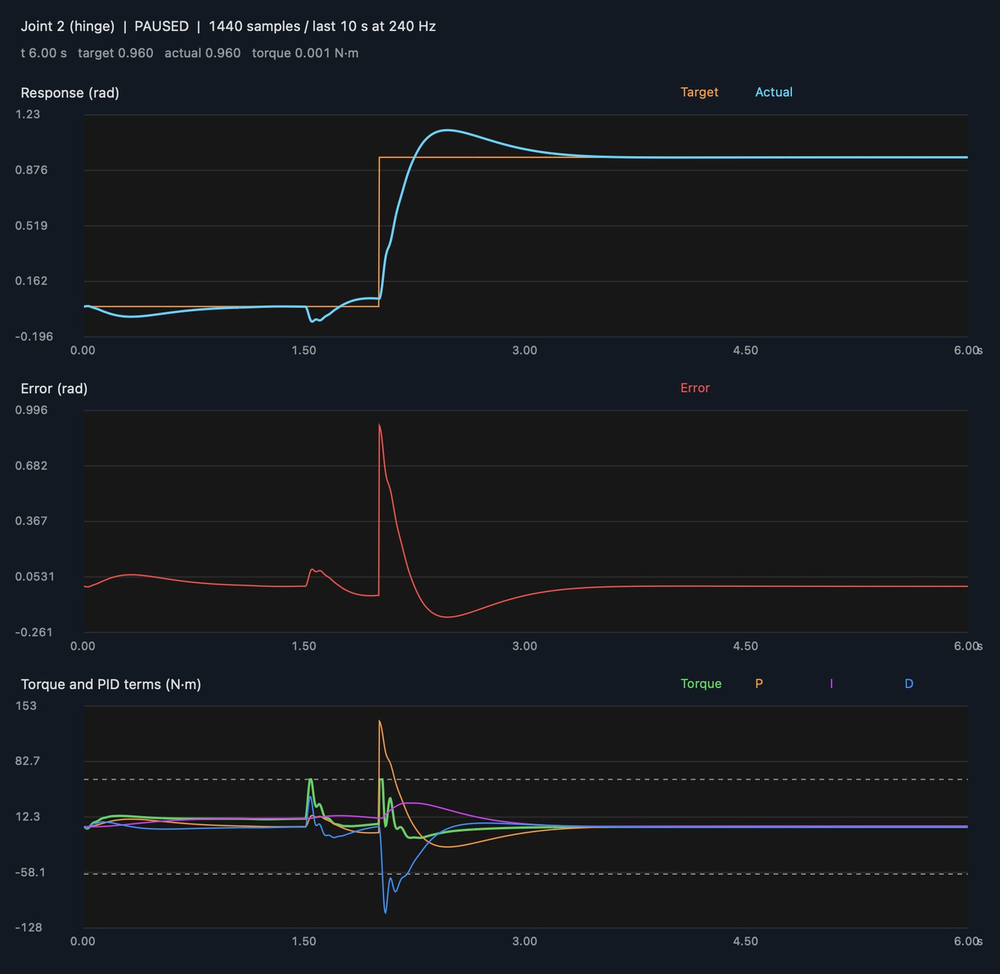
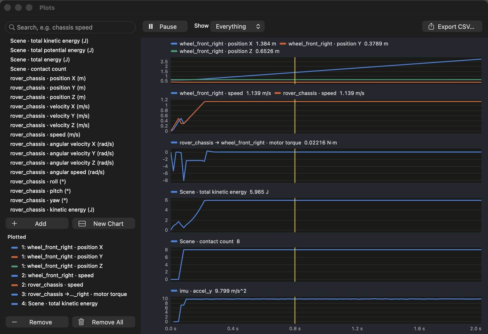
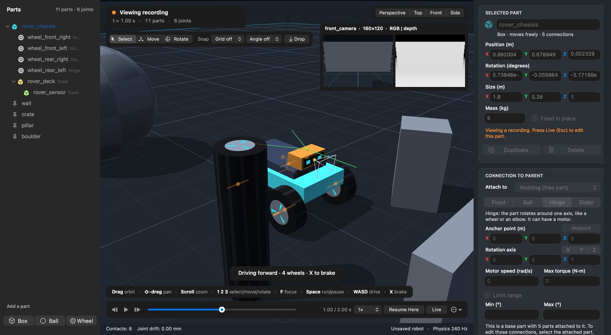
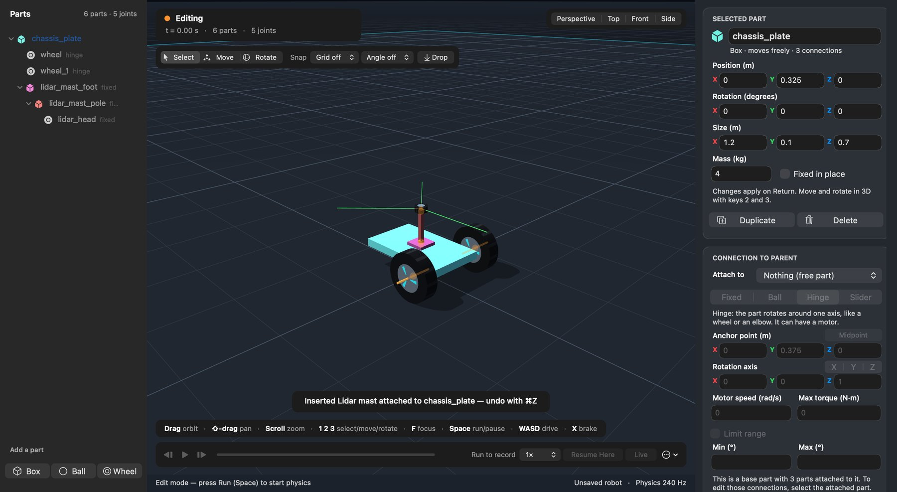
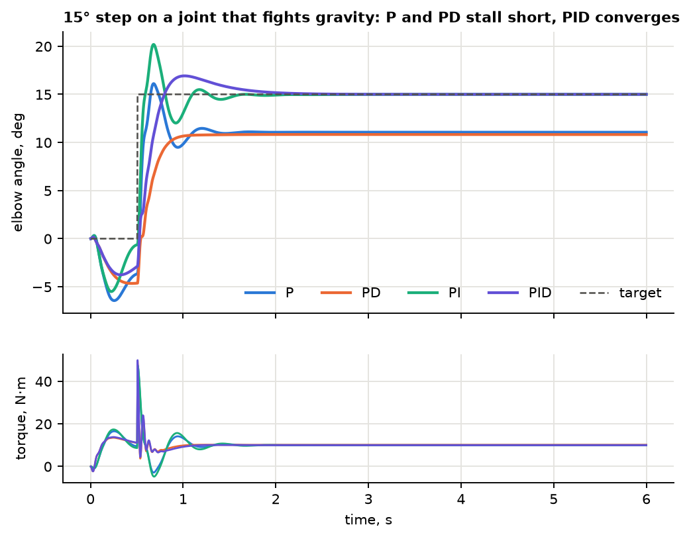
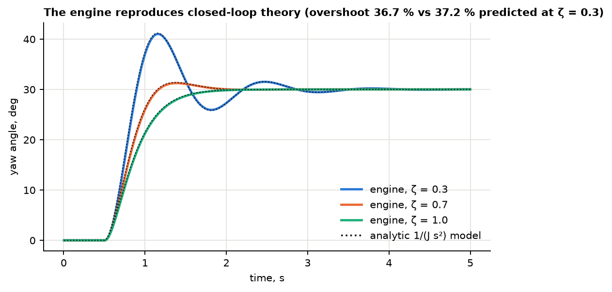
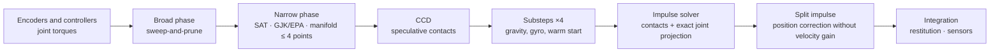
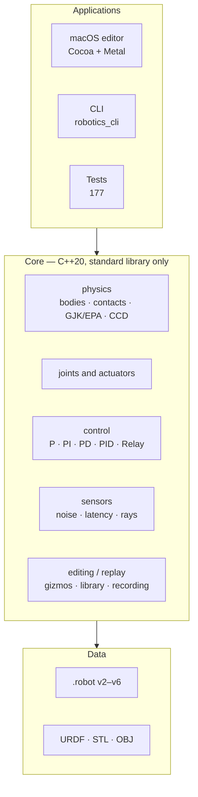

<div align="center">

# 🤖 Robotics Model

**A 3D robot builder and simulator with its own physics engine — pure C++20, no Bullet, PhysX or MuJoCo.**

Assemble a robot from parts, connect them with joints, drive them with motors, add PID controllers and sensors — and watch it work.

[](#build-and-test)
[-000000?logo=apple&logoColor=white)](#quick-start)
[](#architecture)
[](#verified-not-just-it-seems-to-work)
[](#build-and-test)
[](LICENSE)

[Русская версия](README.md) · [User guide (RU)](docs/USER_GUIDE.md) · [Architecture (RU)](docs/ARCHITECTURE.md)



<sub>The 3-DOF manipulator from <code>examples/manipulator_3dof.robot</code>: every joint holds its angle with its own PID controller.</sub>

</div>

---

## What it is

Robotics Model is an educational environment for designing and simulating robots. At its heart is **its own physics core**: rigid-body dynamics with joints, contacts, friction, convex hulls and continuous collision detection. On top of the core sit a macOS graphical builder, a headless command-line simulator, controllers, sensors and a URDF importer.

It is not a wrapper around an existing engine: every line of physics is written here, covered by tests and checked against analytic solutions. A robot is described as a **graph of links and joints**, not a hard-coded "manipulator" or "rover" class, so wheeled platforms, arms and linear actuators all live in the same model.

## Highlights

| | |
|---|---|
| ⚙️ **Own engine** | Substepped dynamics (TGS-like), up to 4-point contact manifolds, warm starting, split impulse, gyroscopic term, sweep-and-prune, GJK/EPA, CCD. Zero third-party libraries. |
| 🎛 **PID lab** | P, PI, PD, PID and Relay on any joint; the **Control Lab** window plots response, error and the P/I/D contributions; live tuning, anti-windup, CSV/PNG export. |
| 📡 **Noisy sensors** | Encoders, IMU, force/torque, contact, rangefinder, 2D lidar, RGB and depth cameras. Noise, bias, quantization, latency, dropouts. Close the PID loop through a noisy encoder and watch it degrade. |
| 🧱 **Builder** | Build part by part, 3D move/rotate gizmos with grid snapping, undo/redo for everything, a library of ready-made modules. |
| ⏪ **Record & rewind** | Every run is recorded at 60 fps; timeline scrubbing, frame stepping, "resume from here". |
| 📈 **Plot anything** | Positions, velocities, energy, joint reactions, contact counts, sensor channels — with export. |
| 🔁 **Deterministic** | Same input → bit-identical output. Two independent runs produce identical logs. |
| 📥 **URDF import** | Own XML parser, STL/OBJ, convex collision hulls built from meshes. |

## Quick start

macOS with Command Line Tools (`clang++`, `make`). No third-party dependencies.

```sh
git clone https://github.com/Jekov-Evgen/RoboticsModel.git
cd RoboticsModel
make            # core, CLI, tests and the editor
make test       # 177 automated tests
open build/RoboticsModel.app
```

The editor opens with a four-wheel rover. Click the 3D view: **W/S** drive, **A/D** turn, **Space** run/pause. **Examples** loads an arm, a PID test bench, a linear actuator, a rover with lidar and URDF robots; open `examples/manipulator_3dof.robot` via **File → Open**.

Headless, on any OS with C++20:

```sh
./build/robotics_cli --scene examples/manipulator_3dof.robot --seconds 10 --csv build/poses.csv
./build/robotics_cli --control-demo --seconds 10 --control-csv build/pid.csv   # PID step response
./build/robotics_cli --urdf examples/urdf/diff_drive.urdf --seconds 5          # import a URDF
```

## See for yourself

<table>
<tr>
<td width="50%"><br><b>Sensors.</b> 2D lidar (green beams) and a depth camera (inset) on a rover. Noise, latency and quantization are set in the inspector.</td>
<td width="50%"><br><b>Control Lab.</b> Response, error and P/I/D contributions (N·m) of one joint. Gains can be changed live.</td>
</tr>
<tr>
<td><br><b>Plot any quantity.</b> Search every channel of the scene; hovering shows values, clicking a plot scrubs the recording.</td>
<td><br><b>Recording and timeline.</b> Scrubbing, frame stepping, 0.25×–4× playback, resume the simulation from any frame.</td>
</tr>
<tr>
<td colspan="2"><br><b>Module library.</b> Drive wheel, servo, linear actuator, gripper, lidar and camera masts, IMU board. Save your own assembly into the library.</td>
</tr>
</table>

## PID controllers in two pictures

A joint that fights gravity is the best test of a controller. P and PD **stop short of the target** (gravity torque can only be balanced by a non-zero error `e = g(q)/Kp`), PID drives the angle to the setpoint:

<p align="center"></p>

Gains are computed from the double-integrator model: `Kp = J·ωn²`, `Kd = 2ζ·ωn·J`. The engine confirms the theory — simulated overshoot differs from the formula by at most 0.5 percentage points:

<p align="center"></p>

What the controller implements:

- P, PI, PD, PID and Relay for **position or velocity** of Hinge and Slider joints;
- the derivative acts on the **measurement**, not the error — no torque kick on a setpoint step; first-order filter;
- two levels of anti-windup: integral clamp and conditional integration during actuator saturation;
- reference signals: constant, step, sine;
- feedback through an **encoder model** (noise, quantization, delay).

## The core as a library

The whole engine is usable without any UI. A complete example — a pedestal, a 1.2 m link and a PID-driven servo:

```cpp
#include "robotics/robotics.hpp"
using namespace robotics;

int main() {
    World world;

    Body base;                         // fixed pedestal
    base.mass = 0;
    base.size = {0.3, 1.0, 0.3};
    base.position = {0, 0.5, 0};
    world.addBody(base);

    Body arm;                          // 1.2 m link, 1 kg
    arm.size = {1.2, 0.16, 0.16};
    arm.position = {0.6, 1.0, 0};
    world.addBody(arm);

    // Hinge about the vertical axis + position PID
    Joint& servo = world.joints[world.connect(0, 1, JointType::Hinge, {0, 1, 0}, {0, 1, 0})];
    servo.maxTorque = 8;
    servo.controller.type   = ControllerType::PID;
    servo.controller.target = 1.0;     // rad
    servo.controller.kp = 14;  servo.controller.ki = 3;  servo.controller.kd = 4;

    for (int i = 0; i < 240 * 5; ++i) world.step();   // 5 s at 240 Hz
    // servo.angle ≈ 1.02 rad
}
```

Build and run (bash/zsh): `clang++ -std=c++20 -Iinclude src/{physics,control,io,scenes,sensors,editing,replay}/*.cpp main.cpp`.

## Python API

The same core from Python, headless. Handles for bodies and joints, `numpy` arrays, string enums:

```python
import robotics_model as rm

world = rm.load_scene("examples/manipulator_3dof.robot")
world.set_joint_targets([0.5, 0.3, 0.8])      # PID setpoints for every joint, rad
world.run(3.0)                                # simulated seconds
print(world.joint_angles(), world.body("tool").position)
```

Install with `pip install .` (needs a C++20 compiler and CMake). Details: [docs/PYTHON.md](docs/PYTHON.md) (Russian).

## Physics inside



| Feature | Detail |
|---|---|
| Bodies and shapes | box, sphere, cylinder (wheel), **convex hull** up to 64 vertices (quickhull, exact mass properties); static floor |
| Joints | Fixed, Ball, Hinge, Slider (Prismatic); speed motor with torque/force limit; **hard range limits** that hold even against the motor |
| Contacts | normal impulses, restitution, Coulomb friction, manifolds of up to 4 points with stable feature IDs for warm starting |
| Stability | a chain with a 1:20 mass ratio keeps anchors within 1 mm; a 6-axis arm holds its pose; a 10-box pyramid drifts under 1 cm in 10 s |
| Fast bodies | **CCD** by GJK distance: a 2 cm ball at 50 m/s stops at a 1 cm plate; a rod spinning at 300 rad/s cannot pass through a thin wall |
| Rotation | gyroscopic term with energy conservation (the Dzhanibekov effect reproduces) |

Details and formulas: [docs/ARCHITECTURE.md](docs/ARCHITECTURE.md) (Russian).

## Verified, not just "it seems to work"

- **177 automated tests** by area: math, contacts, chains, hulls, CCD, joints and limits, controllers, sensors, URDF, file format, recording. All pass, including under **UndefinedBehaviorSanitizer** (`make test-ubsan`).
- **Editor self-check** (`robotics_editor --smoke-test`) drives the real window: part creation, undo/redo, move, Control Lab, reset, saving, sensors, gizmos, timeline, plots, library and GPU rendering.
- **Checks against theory:** hull mass properties against closed-form formulas, GJK against brute force on random polytopes, EPA against SAT on 400 box pairs, lidar against an analytic wall, PD overshoot against the formula.
- **Determinism:** two independent runs of the experiment series produce byte-identical CSVs.
- **Constraint consistency:** joint anchor drift stayed below 0.02 mm in every experiment.

Speed (Apple M2, single thread, 1/240 s step, `robotics_bench`):

| Scene | Steps per second | vs. real time |
|---|---:|---:|
| Rover | 6,451 | ≈ 27× |
| 6-link arm | 19,790 | ≈ 82× |
| Pile of 100 boxes | 1,393 | ≈ 5.8× |
| Two piles of 50 convex hulls | 1,697 | ≈ 7× |

## Sensors

Encoder, joint-velocity sensor, IMU, joint force/torque, contact, rangefinder, 2D lidar, RGB and depth cameras. Every sample runs through a pipeline: sampling rate → bias and drift → Gaussian noise → quantization → dropouts → latency. The noise generator is deterministic per seed. Lidar and rangefinder rays work on convex hulls too. See [docs/SENSORS.md](docs/SENSORS.md) (Russian).

## Importing robots

`File → Import URDF…` (or `--urdf` on the CLI): links become parts, `revolute`/`continuous` become Hinge, `prismatic` becomes Slider; limits and `effort` carry over, axes are converted to Y-up. STL (binary and ASCII) and OBJ meshes are drawn as is, and a convex hull is built for collisions. Anything simplified is listed in a warnings window. The parsers survived 20,000 corrupted files per format without a single crash. Details (UR5, TurtleBot3): [docs/IMPORT.md](docs/IMPORT.md) (Russian).

## Architecture

Layered, with one-way dependencies: the core knows nothing about the editor or the CLI.



```text
include/robotics/   public core API (no UI): math, body, joint, controller, world, ...
src/physics/        world step, collisions, solvers, GJK/EPA, CCD, hulls
src/control/        controllers
src/sensors/        measurement models, ray casting
src/io/             .robot format, URDF, XML parser, STL/OBJ
src/editing/        assembly edits, gizmos, part library
src/replay/         simulation recording, plot channels
src/scenes/         built-in examples
src/cli/            command-line program
src/mac/            macOS builder (Cocoa + Metal)
tests/              tests by area
examples/           ready-made scenes (.robot) and URDFs
docs/               documentation
```

## Honest limits

This is an **educational rigid-body simulator**, not a replacement for an industrial environment:

- no soft bodies, tire deformation, suspension or fluids; no joint friction or damping; no sleeping;
- cylinder–box and cylinder–cylinder contacts use a 32-sided prism (height ripple ≈ 0.5 % of the radius);
- non-convex meshes are replaced by a convex hull;
- **the graphical editor runs on macOS only**; the core, CLI and tests are portable C++20, but only an Apple Clang build has been verified;
- passing tests confirm the checked scenarios, not physical fidelity of an arbitrary design.

## Roadmap

- [x] Python bindings (`pip install .`, numpy, headless mode) — [docs/PYTHON.md](docs/PYTHON.md)
- [ ] Gym-style interface for reinforcement learning
- [ ] Gravity and velocity feedforward in the controllers, inverse kinematics and trajectory planning
- [ ] ROS 2 bridge
- [ ] Comparison with MuJoCo on identical scenes
- [ ] Renderer and editor for Linux/Windows
- [ ] Sleeping, joint friction and damping

## Documentation

All documentation is currently in Russian.

| File | About |
|---|---|
| [docs/USER_GUIDE.md](docs/USER_GUIDE.md) | using the editor, building a robot, shortcuts, examples |
| [docs/ARCHITECTURE.md](docs/ARCHITECTURE.md) | modules, mathematical model, physics step, `.robot` formats |
| [docs/CONTROLLERS.md](docs/CONTROLLERS.md) | controllers, Control Lab, tuning |
| [docs/SENSORS.md](docs/SENSORS.md) | sensors, noise, latency |
| [docs/PYTHON.md](docs/PYTHON.md) | Python API: install, handles, controllers, sensors |
| [docs/IMPORT.md](docs/IMPORT.md) | URDF, STL, OBJ import |

## Build and test

```sh
make                 # core, CLI, tests, editor (macOS) and build/RoboticsModel.app
make test            # 177 tests
make test-ubsan      # the same under UndefinedBehaviorSanitizer
make format          # clang-format
```

CMake (core, CLI and tests on any OS with C++20):

```sh
cmake -S . -B build/cmake -DCMAKE_BUILD_TYPE=Release
cmake --build build/cmake --config Release
ctest --test-dir build/cmake -C Release --output-on-failure
```

## License

[MIT](LICENSE) — use it freely.
