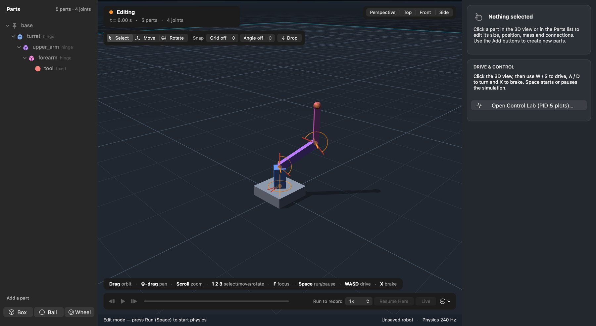
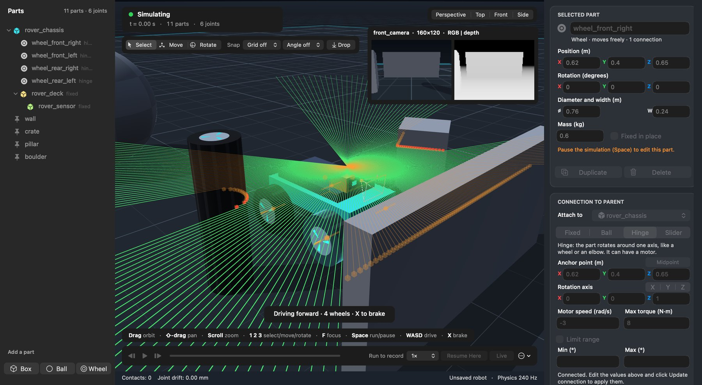
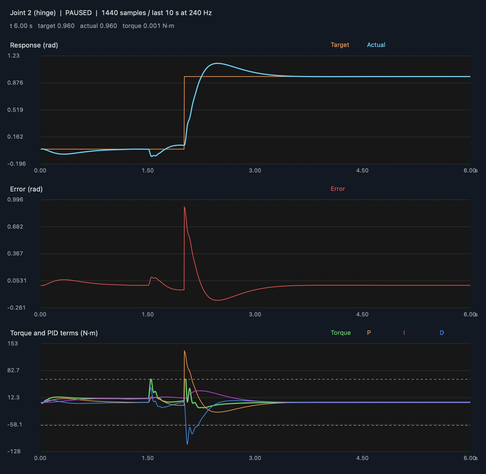
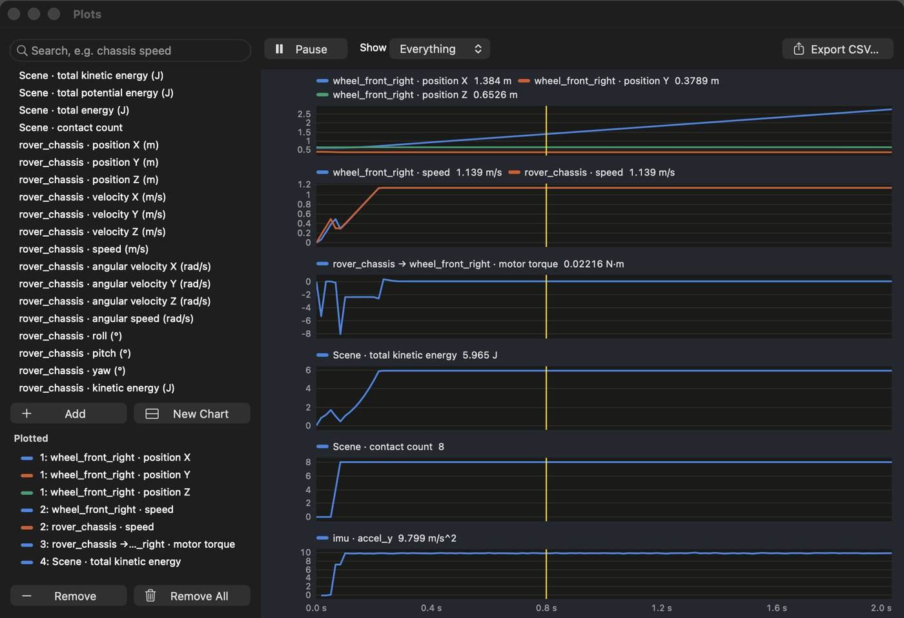
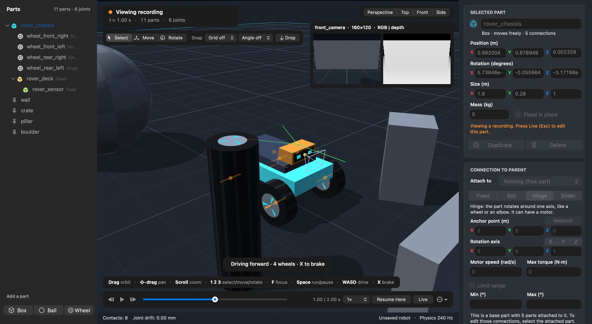
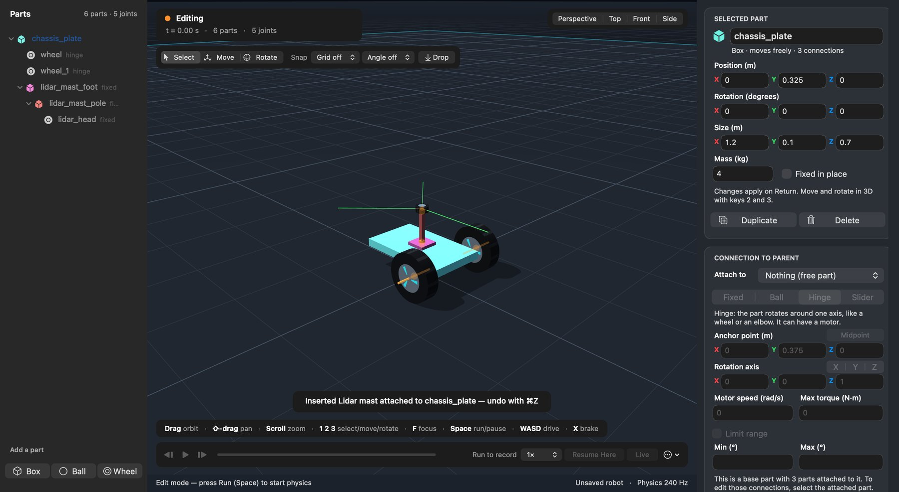
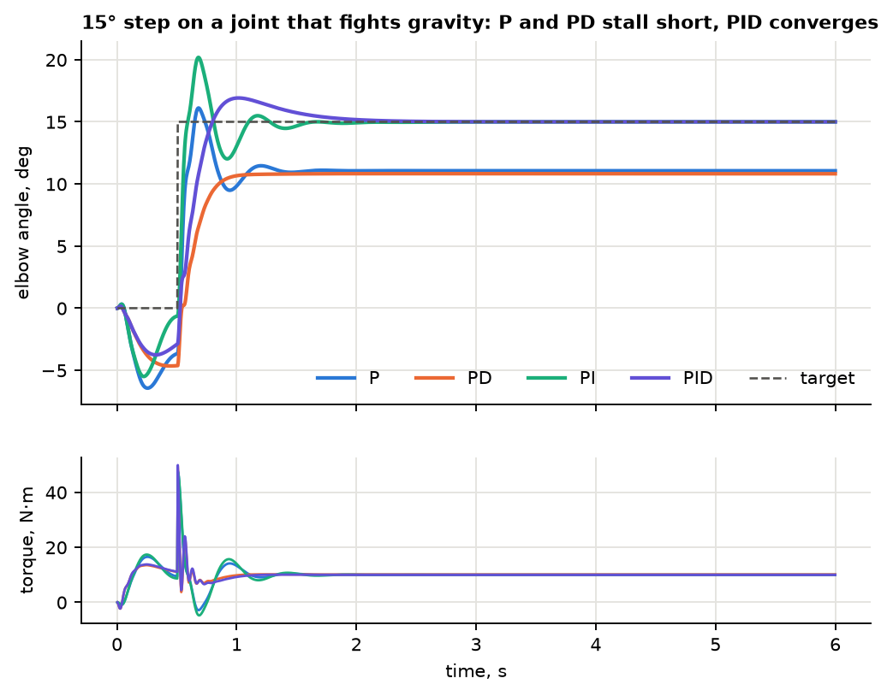
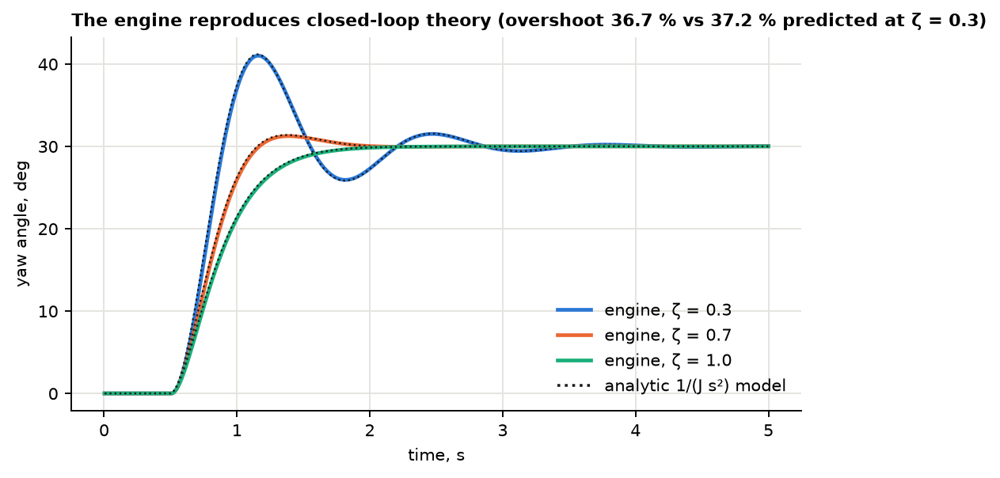
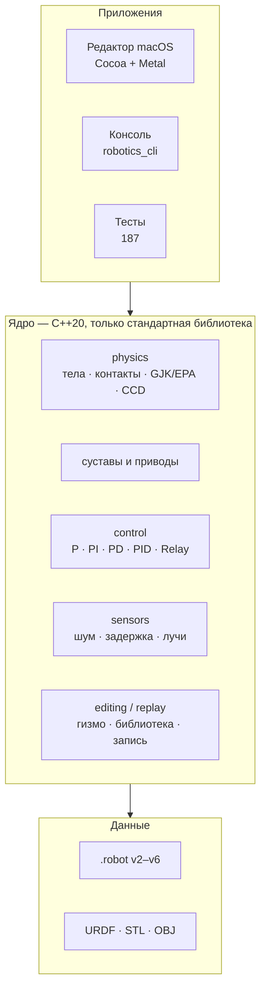

<div align="center">

# 🤖 Robotics Model

**Конструктор и симулятор роботов в 3D со своим физическим движком — на чистом C++20, без Bullet, PhysX и MuJoCo.**

Собери робота из деталей, соедини суставами, посади на привод, повесь PID и датчики — и смотри, как он работает.

[](#сборка-и-тесты)
[-000000?logo=apple&logoColor=white)](#быстрый-старт)
[](#архитектура)
[](#проверено-а-не-вроде-работает)
[](#сборка-и-тесты)
[](LICENSE)

[English version](README.en.md) · [Руководство пользователя](docs/USER_GUIDE.md) · [Архитектура](docs/ARCHITECTURE.md)



<sub>Трёхосевой манипулятор из <code>examples/manipulator_3dof.robot</code>: каждый сустав держит угол своим PID-регулятором.</sub>

</div>

---

## Что это

Robotics Model — учебная среда конструирования и моделирования роботов. Внутри — **собственное физическое ядро**: динамика твёрдых тел с суставами, контактами, трением, выпуклыми оболочками и непрерывным обнаружением столкновений. Поверх ядра — графический конструктор для macOS, консольный симулятор, регуляторы, датчики и импорт URDF.

Это не обёртка над готовым движком: каждая строчка физики написана здесь, покрыта тестами и сверена с аналитическими решениями. Робот описывается **графом звеньев и соединений**, а не заранее заданным классом «манипулятор» или «ровер», поэтому в одной модели живут колёсные платформы, манипуляторы и линейные приводы.

## Чем это интересно

| | |
|---|---|
| ⚙️ **Свой движок** | Динамика с подшагами (TGS-подобная схема), контактный манифольд до 4 точек, warm starting, split impulse, гироскопический член, sweep-and-prune, GJK/EPA, CCD. Ноль сторонних библиотек. |
| 🎛 **PID-лаборатория** | P, PI, PD, PID и Relay на любом шарнире; окно **Control Lab** с графиками отклика, ошибки и вкладов P/I/D; настройка «на ходу», anti-windup, экспорт CSV/PNG. |
| 📡 **Датчики с шумом** | Энкодеры, IMU, силы/моменты, касание, дальномер, 2D-лидар, RGB- и depth-камера. Шум, смещение, квантование, задержка, пропуски. Можно замкнуть PID через «шумный» энкодер и увидеть, как он ломается. |
| 🧱 **Конструктор** | Собираешь деталь за деталью, ручки перемещения и поворота прямо в 3D, привязка к сетке, Undo/Redo на всё, библиотека готовых узлов. |
| ⏪ **Запись и перемотка** | Каждый запуск пишется (60 кадров/с); таймлайн, покадровый шаг, «продолжить отсюда». |
| 📈 **Графики чего угодно** | Положения, скорости, энергия, реакции в соединениях, число контактов, каналы датчиков — на графиках, с экспортом. |
| 🔁 **Детерминизм** | Одинаковый вход → побитово одинаковый результат. Два независимых запуска дают идентичные журналы. |
| 📥 **Импорт URDF** | Свой XML-парсер, STL/OBJ, выпуклые оболочки столкновений из мешей. |

## Быстрый старт

Нужны macOS и Command Line Tools (`clang++`, `make`). Сторонних зависимостей нет.

```sh
git clone https://github.com/Jekov-Evgen/RoboticsModel.git
cd RoboticsModel
make            # ядро, консоль, тесты и редактор
make test       # 187 автоматических тестов
open build/RoboticsModel.app
```

Откроется конструктор со стартовым четырёхколёсным ровером. Кликните по 3D-виду: **W/S** — вперёд/назад, **A/D** — разворот, **Space** — Run/Pause. Меню **Examples** загружает манипулятор, PID-стенд, линейный привод, ровер с лидаром, URDF-роботов; файл `examples/manipulator_3dof.robot` открывается через **File → Open**.

Без окна, на любой ОС с C++20:

```sh
./build/robotics_cli --scene examples/manipulator_3dof.robot --seconds 10 --csv build/poses.csv
./build/robotics_cli --control-demo --seconds 10 --control-csv build/pid.csv   # переходный процесс PID
./build/robotics_cli --urdf examples/urdf/diff_drive.urdf --seconds 5          # импорт URDF
```

## Посмотрите сами

<table>
<tr>
<td width="50%"><br><b>Датчики.</b> 2D-лидар (зелёные лучи) и depth-камера (картинка в углу) на ровере. Шум, задержка и квантование настраиваются в инспекторе.</td>
<td width="50%"><br><b>Control Lab.</b> Отклик, ошибка и вклады P/I/D (Н·м) одного сустава. Коэффициенты меняются на ходу.</td>
</tr>
<tr>
<td><br><b>Графики любых величин.</b> Поиск по всем каналам сцены, наведение показывает значения, клик по графику перематывает запись.</td>
<td><br><b>Запись и таймлайн.</b> Перемотка, покадровый шаг, воспроизведение со скоростью 0,25×–4×, возобновление симуляции с выбранного кадра.</td>
</tr>
<tr>
<td colspan="2"><br><b>Библиотека узлов.</b> Ведущее колесо, сервопривод, линейный привод, захват, мачты с лидаром и камерой, плата IMU. Любую свою сборку можно сохранить в библиотеку.</td>
</tr>
</table>

## PID-регуляторы: главное в двух картинках

Сустав манипулятора, который борется с гравитацией, — лучший тест регулятора. P и PD останавливаются **не доходя до цели** (момент тяжести можно уравновесить только ненулевой ошибкой `e = g(q)/Kp`), PID доводит угол до задания:

<p align="center"></p>

Коэффициенты рассчитываются по модели двойного интегратора: `Kp = J·ωn²`, `Kd = 2ζ·ωn·J`. Движок подтверждает теорию — перерегулирование на симуляции отличается от формулы не более чем на 0,5 процентного пункта:

<p align="center"></p>

Что реализовано в регуляторе:

- P, PI, PD, PID и Relay для **положения или скорости** суставов Hinge и Slider;
- производная считается **по измерению**, а не по ошибке — нет «пинка» момента при скачке задания; фильтр первого порядка;
- два уровня anti-windup: ограничение интеграла и условное интегрирование при насыщении привода;
- сигналы задания: константа, ступенька, синусоида;
- замыкание контура через **модель энкодера** (шум, квантование, задержка).

## Ядро как библиотека

Весь движок доступен без UI. Вот полный пример — стойка, звено 1,2 м и сервопривод с PID:

```cpp
#include "robotics/robotics.hpp"
using namespace robotics;

int main() {
    World world;

    Body base;                         // неподвижная стойка
    base.mass = 0;
    base.size = {0.3, 1.0, 0.3};
    base.position = {0, 0.5, 0};
    world.addBody(base);

    Body arm;                          // звено 1,2 м, 1 кг
    arm.size = {1.2, 0.16, 0.16};
    arm.position = {0.6, 1.0, 0};
    world.addBody(arm);

    // Шарнир вокруг вертикальной оси + PID по положению
    Joint& servo = world.joints[world.connect(0, 1, JointType::Hinge, {0, 1, 0}, {0, 1, 0})];
    servo.maxTorque = 8;
    servo.controller.type   = ControllerType::PID;
    servo.controller.target = 1.0;     // рад
    servo.controller.kp = 14;  servo.controller.ki = 3;  servo.controller.kd = 4;

    for (int i = 0; i < 240 * 5; ++i) world.step();   // 5 с при 240 Гц
    // servo.angle ≈ 1.02 рад
}
```

Собрать и запустить (bash/zsh): `clang++ -std=c++20 -Iinclude src/{physics,control,io,scenes,sensors,editing,replay}/*.cpp main.cpp`.

## Python API

То же ядро — из Python, без окна. Дескрипторы тел и суставов, `numpy`-массивы, строковые перечисления:

```python
import robotics_model as rm

world = rm.load_scene("examples/manipulator_3dof.robot")
world.set_joint_targets([0.5, 0.3, 0.8])      # цели PID по всем суставам, рад
world.run(3.0)                                # секунды симуляции
print(world.joint_angles(), world.body("tool").position)
```

Кинематика и траектории (общая для любой цепочки суставов, не только этого манипулятора):

```python
chain = world.make_chain("tool")                      # цепочка от базы до инструмента
ik = chain.solve_ik([0.9, 1.2, -0.4])                 # обратная кинематика (DLS), ik.q, ik.converged
line = chain.plan_line(chain.coordinates(), [0.9, 1.2, -0.4], max_velocity=0.5, max_acceleration=2.0)
log = rm.follow_trajectory(world, chain, line)        # прогон траектории через PID суставов
```

Установка: `pip install .` (нужны компилятор C++20 и CMake). Подробности — в [docs/PYTHON.md](docs/PYTHON.md), [docs/PLANNING.md](docs/PLANNING.md) и [docs/GYM.md](docs/GYM.md).

## Физика внутри


| Возможность | Деталь |
|---|---|
| Тела и формы | коробка, сфера, цилиндр (колесо), **выпуклая оболочка** до 64 вершин (quickhull, точные массовые свойства); неподвижный пол |
| Соединения | Fixed, Ball, Hinge, Slider (Prismatic); скоростной мотор с ограничением момента/силы; **жёсткие ограничения хода**, которые держат и против мотора |
| Контакты | нормальные импульсы, коэффициент восстановления, кулоновское трение, манифольд до 4 точек со стабильными ID для warm starting |
| Устойчивость | цепочка с отношением масс 1:20 держит крепления в пределах 1 мм; манипулятор с 6 осями держит позу; пирамида из 10 коробок за 10 с смещается меньше 1 см |
| Быстрые тела | **CCD** по расстоянию GJK: шарик на 50 м/с останавливается о пластину в 1 см, стержень на 300 рад/с не проходит сквозь тонкую стену |
| Динамика вращения | гироскопический член с сохранением энергии (воспроизводится эффект Джанибекова) |

Подробности и формулы — в [docs/ARCHITECTURE.md](docs/ARCHITECTURE.md).

## Проверено, а не «вроде работает»

- **187 автоматических тестов** по областям: математика, контакты, цепочки, оболочки, CCD, суставы и ограничения, регуляторы, датчики, URDF, формат файлов, запись. Все проходят, в том числе под **UndefinedBehaviorSanitizer** (`make test-ubsan`).
- **Автопроверка редактора** (`robotics_editor --smoke-test`) прогоняет настоящее окно: создание деталей, Undo/Redo, перенос, Control Lab, Reset, сохранение, датчики, гизмо, таймлайн, графики, библиотеку и GPU-рендер.
- **Сверка с теорией и с MuJoCo:** массовые свойства оболочек против аналитических формул, GJK против перебора на случайных многогранниках, EPA против SAT на 400 парах, лидар против аналитической стены, перерегулирование PD против формулы. Шесть динамических сценариев сверены с аналитикой и **MuJoCo** (маятники, PD-сустав, манипулятор, трение, опрокидывание тела): [docs/VALIDATION.md](docs/VALIDATION.md).
- **Детерминизм:** два независимых запуска серии экспериментов дают побайтово идентичные CSV.
- **Согласованность связей:** во всех экспериментах расхождение креплений суставов не превышало 0,02 мм.

Скорость (Apple M2, один поток, шаг 1/240 с, `robotics_bench`):

| Сцена | Шагов в секунду | К реальному времени |
|---|---:|---:|
| Ровер | 6 451 | ≈ 27× |
| Манипулятор, 6 звеньев | 19 790 | ≈ 82× |
| Куча из 100 коробок | 1 393 | ≈ 5,8× |
| Две кучи по 50 выпуклых оболочек | 1 697 | ≈ 7× |

## Датчики

Энкодер, датчик скорости, IMU, сила/момент в соединении, касание, дальномер, 2D-лидар, RGB- и depth-камера. Каждый отсчёт проходит конвейер: частота опроса → смещение и дрейф → гауссов шум → квантование → пропуски → задержка. Генератор шума детерминирован по зерну. Лучи лидара и дальномера работают и по выпуклым оболочкам. Подробности: [docs/SENSORS.md](docs/SENSORS.md).

## Импорт роботов

`File → Import URDF…` (или `--urdf` в консоли): звенья становятся деталями, `revolute`/`continuous` — Hinge, `prismatic` — Slider; пределы и `effort` переносятся, оси приводятся к Y-вверх. Меши STL (двоичный и ASCII) и OBJ рисуются как есть, а для столкновений строится выпуклая оболочка. Всё, что пришлось упростить, перечисляется в окне предупреждений. Парсеры проверены на 20 тысячах испорченных файлов на формат без единого сбоя. Подробности (UR5, TurtleBot3): [docs/IMPORT.md](docs/IMPORT.md).

## Архитектура

Слои с однонаправленными зависимостями: ядро ничего не знает ни о редакторе, ни о консоли.



```text
include/robotics/   публичный API ядра (без UI): math, body, joint, controller, world, ...
src/physics/        шаг мира, столкновения, решатели, GJK/EPA, CCD, оболочки
src/control/        регуляторы
src/sensors/        модели измерений, лучи
src/io/             формат .robot, URDF, XML-парсер, STL/OBJ
src/editing/        правки сборок, гизмо, библиотека деталей
src/replay/         запись симуляции, каналы графиков
src/kinematics/     цепочки суставов, прямая и обратная кинематика, траектории
src/scenes/         встроенные примеры
src/cli/            консольная программа
src/mac/            конструктор macOS (Cocoa + Metal)
tests/              тесты по областям
examples/           готовые сцены (.robot) и URDF
docs/               документация
```

## Честно о границах

Это **учебный rigid-body симулятор**, а не замена промышленной среде:

- нет мягких тел, деформации шин, подвески, жидкостей; нет трения и демпфирования в суставах; нет sleeping;
- контакты цилиндр–коробка и цилиндр–цилиндр считаются по 32-гранной призме (перепад высоты ≈ 0,5 % радиуса);
- невыпуклые меши заменяются выпуклой оболочкой;
- **графический редактор работает только на macOS**; ядро, консоль и тесты — переносимый C++20, но проверялась сборка только Apple Clang;
- результаты тестов подтверждают проверенные сценарии, но не физическую достоверность произвольной конструкции.

## Дорожная карта

- [x] Python-привязки (`pip install .`, numpy, режим без окна) — [docs/PYTHON.md](docs/PYTHON.md)
- [x] Интерфейс Gymnasium для обучения с подкреплением — [docs/GYM.md](docs/GYM.md)
- [x] Прямая и обратная кинематика, траектории minimum-jerk и прямые в пространстве — [docs/PLANNING.md](docs/PLANNING.md)
- [ ] Гравитационное и скоростное feedforward в регуляторах; планирование с обходом препятствий
- [x] Мост ROS 2 (узел `rclpy`, `/joint_states`, `/tf`, датчики, `/cmd_vel`) — [docs/ROS2.md](docs/ROS2.md); проверен на заглушках, **на живом ROS 2 ещё не запускался**
- [x] Сравнение с MuJoCo на одинаковых сценах — [docs/VALIDATION.md](docs/VALIDATION.md)
- [ ] Рендер и редактор для Linux/Windows
- [ ] Sleeping, трение и демпфирование в суставах

## Документация

| Файл | О чём |
|---|---|
| [docs/USER_GUIDE.md](docs/USER_GUIDE.md) | как пользоваться редактором, сборка робота, клавиши, примеры |
| [docs/ARCHITECTURE.md](docs/ARCHITECTURE.md) | модули, математическая модель, шаг физики, форматы `.robot` |
| [docs/CONTROLLERS.md](docs/CONTROLLERS.md) | регуляторы, Control Lab, настройка |
| [docs/SENSORS.md](docs/SENSORS.md) | датчики, шум, задержка |
| [docs/PYTHON.md](docs/PYTHON.md) | Python API: установка, дескрипторы, регуляторы, датчики |
| [docs/ROS2.md](docs/ROS2.md) | мост ROS 2: темы, соглашения, статус проверки |
| [docs/PLANNING.md](docs/PLANNING.md) | кинематика, ОЗК, траектории: методы, ограничения, измерения |
| [docs/GYM.md](docs/GYM.md) | окружение Gymnasium `ArmReach-v0`, пример обучения |
| [docs/VALIDATION.md](docs/VALIDATION.md) | сверка с аналитикой и MuJoCo: методика и результаты |
| [docs/IMPORT.md](docs/IMPORT.md) | импорт URDF, STL, OBJ |

## Сборка и тесты

```sh
make                 # ядро, консоль, тесты, редактор (macOS) и build/RoboticsModel.app
make test            # 187 тестов
make test-ubsan      # то же под UndefinedBehaviorSanitizer
make format          # clang-format
```

CMake (ядро, консоль и тесты — на любой ОС с C++20):

```sh
cmake -S . -B build/cmake -DCMAKE_BUILD_TYPE=Release
cmake --build build/cmake --config Release
ctest --test-dir build/cmake -C Release --output-on-failure
```

## Лицензия

[MIT](LICENSE) — пользуйтесь на здоровье.
