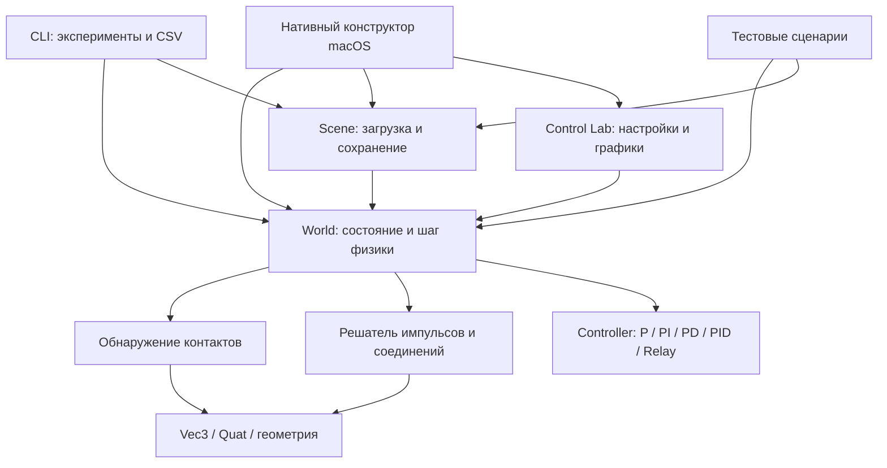

# Архитектура среды моделирования роботов

## Цель и граница первой версии

Разделить описание конструкции, расчёт динамики и представление результатов. Тогда один и тот же робот можно запускать в редакторе, тесте или пакетном эксперименте; добавление другого интерфейса не меняет физику.

В текущей версии робот — граф: вершины представляют твёрдые тела, рёбра — соединения. Поддерживаются разветвлённые конструкции, свободные тела и замкнутые цепи. Возможность записать цикл в графе не гарантирует устойчивость или совместимость его ограничений: сборка должна быть физически согласована. «Универсальный» здесь означает расширяемое представление, а не поддержку любой физики с первого дня.

## Слои и зависимости



Ядро разделено на модули по ответственности (см. «Карта модулей»). Абстракций «на вырост» нет: каждый модуль — набор свободных функций с узким внутренним заголовком. При появлении второй реализации broad phase или решателя соответствующий блок можно вынести за интерфейс.

| Блок | Ответственность | Не должен делать |
|---|---|---|
| Math | Векторная и кватернионная математика | Знать об окнах и файлах |
| Body | Состояние тела, инерция, приложение силы/импульса | Выбирать стратегию управления роботом |
| Joint | Локальные якоря, оси, тип связи, параметры мотора | Рисовать элементы интерфейса |
| World | Шаг физики, контакты, совместное решение ограничений | Зависеть от Cocoa |
| Controller | Задание, обратная связь, ограничение момента, состояние I/D | Знать о геометрии и интерфейсе |
| Control Lab | Параметры регулятора и графики телеметрии | Повторять расчёты регулятора |
| Scene | Версия формата, сериализация, проверка входа | Запускать динамику при загрузке |
| Editor | Изменение конструкции, камера, команды симуляции | Дублировать формулы физики |
| CLI | Воспроизводимые прогоны и измерения | Требовать графического дисплея |

Сейчас индексы тел — идентификаторы внутри сцены. Удаление тела удаляет связанные рёбра и перенумеровывает оставшиеся индексы. Для Undo, внешних ссылок и URDF позже нужны устойчивые UUID/handles.

## Запись и просмотр

`Recording` хранит кадр каждые 4 шага физики (положения, скорости, координаты и усилия соединений, контакты, до 12 каналов на датчик) и полный снимок `World` без телеметрии каждые 30 кадров. Старые кадры удаляются блоками до следующего снимка, поэтому первый кадр всегда можно восстановить. `restore()` берёт ближайший снимок, повторяет шаги с записанными командами моторов и даёт полное состояние, включая контакты, регуляторы и генераторы шума: продолжение совпадает с исходным запуском (`tests/test_replay.cpp`). Расход памяти — около 0.22 МБ/с на стартовом ровере с датчиками.

В режиме просмотра `sceneWorld` отдаёт `_reviewWorld`, а `_world` не меняется. Любая правка конструкции проходит через `invalidateSnapshot` и очищает запись: кадры ссылаются на индексы тел. Графики читают только запись, поэтому всё видимое на таймлайне можно построить.

## Карта модулей

```text
include/robotics/            Публичный API ядра (без UI, без платформенных зависимостей)
  math.hpp                   Vec3, Quat, rotationVector
  body.hpp                   Shape, Body (форма, масса, состояние, инерция, импульсы)
  joint.hpp                  JointType (Fixed/Ball/Hinge/Prismatic), Joint (топология, локальные
                             рамки, привод, ограничения хода, энкодер, телеметрия, результаты
                             решателя за шаг), Joint::setLimits
  contact.hpp                Contact (точка, нормаль, глубина, накопленные импульсы)
  controller.hpp             ControllerConfig/State/Sample, evaluateController, CSV
  world.hpp                  World: addBody, connect, removeBody, validate, step
  demo_scenes.hpp            makeDemo, makeControlDemo, makeLinearActuatorDemo, makeRoverDemo, driveRover
  io/robot_format.hpp        Формат .robot: writeScene/readScene/saveScene/loadScene
  io/urdf.hpp                Импорт URDF: loadUrdf/importUrdf, UrdfImportOptions, предупреждения
  io/mesh.hpp                TriangleMesh, readStl/readObj/loadMesh, MeshCache
  scene.hpp                  Заголовок совместимости (= io/robot_format.hpp + demo_scenes.hpp)
  sensors/sensor.hpp         SensorType, NoiseModel, Sensor (конфигурация + состояние), хранится в World::sensors
  sensors/sensor_system.hpp  updateSensors, stepSimulation, makeSensor, validateSensors, CSV датчиков
  sensors/raycast.hpp        Точные лучи: raycastBody / raycastGround / raycast(World)
  editing/assembly.hpp       Сборка = деталь и всё ниже неё: moveAssembly, rotateAssembly, dropAssemblyToFloor
  editing/gizmo.hpp          Гизмо: попадание по ручкам, перетаскивание по оси/плоскости/кольцу, привязка
  editing/library.hpp        Библиотека: builtinLibrary, insertLibraryItem, extractAssembly, customLibraryItem
  replay/recording.hpp       Recording: лёгкие кадры 60 Гц + снимок World каждые 0.5 с, view, restore
  replay/channels.hpp        Каналы графиков: listChannels, channelValue, rebindChannel, CSV
  robotics.hpp               Зонтичный заголовок ядра (для привязок и утилит)
src/physics/                 Динамика (библиотека robotics)
  world.cpp                  Конвейер шага (подшаги), добавление/удаление, проверка данных
  body.cpp                   Главные моменты инерции, импульсы, вершины
  convex_hull.cpp            Quickhull, массовые свойства многогранника, главные оси, луч по оболочке
  broadphase.{hpp,cpp}       Sweep and prune по AABB, эталонный перебор для тестов
  collision.{hpp,cpp}        Narrow phase: земля, сферы, SAT выпуклых многогранников + clipping
                             граней (manifold до 4 точек), feature id; коэффициент отскока
  gjk.{hpp,cpp}              GJK (расстояние) и EPA (глубина) для наборов точек
  ccd.{hpp,cpp}              Непрерывные столкновения: прогноз движения, заметённые AABB, время удара
  contact_solver.{hpp,cpp}   Контакт: непроникание + трение (круг Кулона), warm starting,
                             split impulse, отскок; сопоставление контактов между шагами
  joint_solver.{hpp,cpp}     Строки соединений: геометрия по типам, моторы, ограничения хода
  joint_direct.{hpp,cpp}     Точное решение двусторонних строк соединений (разреженный блочный LDLᵀ)
  integrator.{hpp,cpp}       Интегрирование подшага: силы, гироскопический член (неявная средняя точка)
  solver_body.hpp            Копия тела для решателя: мировой тензор I⁻¹, импульсы
  actuators.{hpp,cpp}        Энкодеры (угол / смещение), регуляторы, телеметрия Speed motor
src/control/controller.cpp   P/PI/PD/PID/Relay, сигналы задания, anti-windup, CSV
src/io/                      Ввод-вывод сцен
  robot_format.cpp           Разбор текста → записи (ParsedScene) → World; запись
  text_reader.hpp            Общие функции чтения токенов для текстовых форматов
  xml.{hpp,cpp}              Минимальный XML-парсер (строка/столбец в ошибках), внутренний
  urdf.cpp                   Импорт URDF: разбор → записи звеньев/соединений → World (docs/IMPORT.md)
  mesh.cpp                   Чтение STL (двоичный/ASCII) и OBJ, MeshCache
  atomic_file.hpp            Атомарная запись файла (временный файл + rename)
src/scenes/demo_scenes.cpp   Встроенные примеры (в т.ч. Sensor Rover, Noisy PID)
src/sensors/                 Датчики (docs/SENSORS.md): sensors.cpp — модели, шум, такт, задержка;
                             raycast.cpp — пересечения луча с box/sphere/cylinder и полом
src/cli/main.cpp             Консольный запуск (robotics_cli)
src/mac/                     Редактор macOS (Objective-C++)
  main_mac.mm                Точка входа, флаг --smoke-test
  editor_controller.{h,mm}   EditorController: окно, состояние, Undo, обратная связь, хост вьюпорта,
                             цикл симуляции. Категории в отдельных файлах:
  editor_actions.mm          добавление/дублирование/удаление деталей, примеры, вождение, камера
  editor_documents.mm        открытие/сохранение, несохранённые изменения
  editor_import.mm           импорт URDF и 3D-моделей, примеры URDF, показ форм столкновений
  editor_inspector.mm        инспектор детали и соединения
  editor_menus.mm            меню, панель инструментов, проверка доступности команд
  editor_parts_list.mm       дерево деталей
  editor_smoke_test.mm       автопроверка --smoke-test
  control_lab.{h,mm}         окно Control Lab и графики (источник обратной связи: идеальный / энкодер)
  editor_sensors.mm          карточка «Sensors» в инспекторе, камера (картинка в картинке), запись CSV
  sensor_panel.{h,mm}        окно Sensors: показания, график канала, скан лидара, изображения камеры
  ui_helpers.{h,mm}          FlippedView, CardView, поля ввода, строки XYZ, разбор чисел
  editor_timeline.mm         запись, таймлайн, просмотр кадров, Resume Here
  editor_library.mm          вставка и сохранение модулей, Drop to Floor, команды Plot
  timeline_bar.{h,mm}        панель таймлайна поверх 3D-вида
  plot_window.{h,mm}         окно Plots
  library_panel.{h,mm}       окно Part Library
  editor_smoke_ux.mm         --smoke-test: гизмо, таймлайн, графики, библиотека через NSEvent
  viewport.{h,mm}            Metal-рендер, камера, выбор, перетаскивание
  app_icon.h                 Векторная иконка (общая с tools/icon_builder.mm)
tests/                       test_harness.hpp, test_main.cpp, test_*.cpp по областям
```

## Правила зависимостей

- **Ядро** (`include/robotics`, `src/physics`, `src/control`, `src/io`, `src/scenes`) — только стандартная библиотека C++20. Никаких Cocoa/Metal/ObjC. Библиотека `robotics` собирается и работает без дисплея.
- `src/physics` не знает о файлах и демо; `src/io` строит `World` только через публичный API ядра; `src/scenes` использует только публичный API.
- Внутренние заголовки (`src/*/*.hpp`, пространство имён `robotics::detail`) не включаются вне своего модуля. Публичные — только из `include/robotics`.
- `src/mac` зависит от ядра, но не наоборот. Физика в UI не дублируется: редактор изменяет `World` и вызывает `step()`.
- `src/cli` и `tests` используют только публичный API.
- В публичных заголовках нет `using namespace`.

## Соглашения о коде

- C++20, предупреждения `-Wall -Wextra -Wpedantic -Wshadow …` (в CMake — интерфейсная цель `robotics::warnings`); сборка должна проходить без предупреждений.
- Форматирование — `.clang-format` (LLVM, отступ 4, 110 колонок, всегда фигурные скобки, одна инструкция на строку). Команда: `make format`. Общие настройки редакторов — `.editorconfig`; набор проверок статического анализа — `.clang-tidy`.
- Имена: типы `CamelCase`, функции/переменные/поля `camelBack`, константы `constexpr` с говорящими именами (`contactBaumgarte`, `Joint::historyCapacity`), пространства имён в нижнем регистре. Поля ObjC-классов — `_name`.
- Одна переменная на объявление, говорящие имена вместо однобуквенных (кроме устоявшихся в формулах `a`, `b`, `n`, `k`).
- `[[nodiscard]]` на чистых геттерах и фабриках, `const` везде, где возможно; ошибки входных данных — исключения `std::runtime_error` с понятным текстом.
- Изменение физики должно сохранять результаты существующих тестов; рефакторинг формул не должен менять порядок операций с плавающей точкой без отдельного обоснования.

## Точки расширения

### Как добавить тип соединения

Так был добавлен Prismatic (Slider); его код — образец для следующих типов.

1. `include/robotics/joint.hpp`: добавить значение **в конец** `JointType` (номер хранится в `.robot` и в сегменте редактора); обновить `isKnownJointType`, `isActuatedJointType` (одна управляемая координата → энкодер, мотор, регуляторы, ограничения, телеметрия), `jointTypeName`. Компилятор (`-Wswitch`) укажет все остальные `switch` по типу.
2. `src/physics/joint_solver.cpp`: геометрия строк в `prepareJoints` (плечи `rA/rB`, ось, ошибки `pointError`/`angularError`, координата), строки типа в `DirectJointSolver::buildRows` (`src/physics/joint_direct.cpp`: `point` — линейное направление в якоре, `angular` — вращательное направление). Мотор и ограничения хода общие для одной свободной координаты (`solveMotor`, `solveLimitRow`, `computeResponses`).
3. Новые параметры — поля `Joint`, проверка в `validateJoint` (`src/physics/world.cpp`).
4. Измерение координаты и скорости: `updateEncoders` и `jointSpeed` в `src/physics/actuators.cpp`; приложение усилия регулятора — `applyControllers`.
5. Формат: новые поля — новая версия `.robot`, чтение старых версий сохраняется (см. `parseJoint`, `formatVersionFor`).
6. Редактор: сегмент `_jointType` (`editor_inspector.mm`, индекс = значение `JointType`), `jointName` (`ui_helpers.mm`), гизмо во `viewport.mm`, список Control Lab.
7. Тесты: `tests/test_joints.cpp` или отдельный `tests/test_<тип>.cpp` (как `test_prismatic_limits.cpp`).

### Данные контактов и реакций для визуализации

После `World::step()` вектор `World::contacts` содержит контакты этого шага с **накопленными** импульсами: `normalImpulse` (Н·с, по `normal`, действует на A), `tangentImpulse` (трение, Н·с), `totalImpulse()`. Средняя сила за шаг = импульс / `dt`. Контакты пересчитываются в начале следующего шага.

Соединения хранят результаты последнего шага: `Joint::reactionImpulse` (линейный импульс связи в якоре, на тело A), `Joint::reactionAngularImpulse` (угловой, без мотора), `Joint::motorImpulse` (импульс мотора по оси). Эти поля только накапливаются и не влияют на расчёт. Рендереру достаточно читать `World` через `SceneViewHost::sceneWorld`.

### Как добавить импортёр (например, URDF)

URDF-импортёр реализован по этому рецепту (`include/robotics/io/urdf.hpp`, `src/io/urdf.cpp`); полное описание — [IMPORT.md](IMPORT.md). Он служит образцом для следующих форматов (например, SDF/MJCF).

1. Публичный заголовок `include/robotics/io/urdf.hpp`: `World importUrdf(std::istream&)` и `World loadUrdf(const std::string& path)`.
2. Реализация `src/io/urdf.cpp` (подхватывается сборкой автоматически). Разделять разбор (текст → промежуточные записи) и построение (`World::addBody`, `World::connect`, `World::validate`), как в `robot_format.cpp` (`parseScene` → `buildWorld`). Общие функции чтения — `src/io/text_reader.hpp`; XML-парсер пишется в `src/io` (сторонние библиотеки запрещены).
3. Выбор формата по расширению — в вызывающем коде (CLI `makeWorld`, редактор `load:` в `editor_documents.mm`).
4. Тесты — `tests/test_urdf.cpp`, примеры — `examples/`.

Соответствие типов URDF (после `addBody` для parent и child; `anchor`/`axis` — мировые точка начала и ось joint в текущей позе):

```cpp
Joint& j = world.joints[world.connect(parent, child, type, anchor, axis)];
```

| URDF | `JointType` | Поля после `connect` |
|---|---|---|
| `revolute` | `Hinge` | `j.setLimits(lower, upper)` (рад), `j.maxTorque = effort` (Н·м) |
| `continuous` | `Hinge` | без ограничений; `maxTorque = effort`, если задан |
| `prismatic` | `Prismatic` | `j.setLimits(lower, upper)` (м), `j.maxTorque = effort` (Н) |
| `fixed` | `Fixed` | — |

`connect` принимает текущую позу за ноль координаты (`Joint::angle`), поэтому тела нужно расставить в позе URDF `q = 0` до соединения. `maxTorque` — это предел усилия Speed motor и регуляторов («effort»); `velocity` из URDF пока не моделируется (можно использовать как `motorSpeed` Speed motor). `floating` и `planar` не поддерживаются; `mimic`, `dynamics` (damping/friction) и `safety_controller` игнорируются.

### Python-привязки

Библиотека `robotics` — статическая, без UI, собирается с `POSITION_INDEPENDENT_CODE`, поэтому её можно слинковать в модуль расширения. Достаточно зонтичного заголовка `robotics/robotics.hpp`. Модуль привязок — отдельная цель CMake (например, `bindings/python`), зависящая от `robotics::robotics`; ядро о Python не знает.

### Как добавить тест

Создать `tests/test_<область>.cpp`:

```cpp
#include "test_harness.hpp"
using namespace robotics;
using namespace test;

TEST_CASE("prismatic joint keeps axis") {
    World world;
    // ...
    check(condition, "message");
    near(actual, expected, tolerance, "message");
}
```

Make и CMake собирают все `tests/*.cpp` в `robotics_tests`; запуск — `make test`, `make test-ubsan`, `ctest`. Путь к корню проекта доступен как `ROBOTICS_SOURCE_DIR`.

## Данные

`Body` хранит форму, полные размеры, массу, позу центра масс, линейную/угловую скорость, накопленные силу/момент, трение и восстановление. Центр геометрии совпадает с центром масс. Масса 0 означает статическое тело. Форма Box использует все три размера; Sphere использует три равных диаметра. Cylinder имеет равные диаметры X/Y и ширину Z; локальная ось — Z.

`makeRoverDemo()` создаёт стартовую сборку редактора: шасси, четыре цилиндрических колеса на Hinge, верхняя панель и декоративная головка на Fixed. Это обычные Body/Joint, а не отдельный неразборный объект. `driveRover()` меняет только уставки Speed motor у цилиндрических звеньев; положение шасси не задаётся напрямую. Движение возникает за счёт моментов и трения, поворот — за счёт разных скоростей сторон и бокового проскальзывания.

`Joint` хранит пару тел, локальные точки крепления и оси. Локальные координаты нужны, чтобы крепление перемещалось вместе с телом. Соединение создаётся из мировой точки и мировой оси, после чего они переводятся в системы обоих тел. У Fixed и Prismatic дополнительно хранится начальная относительная ориентация.

| Тип | Заблокированные степени свободы | Свободные степени свободы |
|---|---|---|
| Ball | 3 поступательных | 3 вращательных |
| Hinge | 3 поступательных + 2 вращательных | Вращение вокруг оси |
| Prismatic (Slider) | 2 поступательных поперёк оси + 3 вращательных | Смещение вдоль оси |
| Fixed | Все 6 | Нет |

Привод есть у Hinge и Prismatic («актуированные» типы, `isActuatedJointType`). Доступны исходный Speed motor (скоростное ограничение с пределом усилия) и P/PI/PD/PID/Relay, которые формируют физическое усилие по ошибке координаты или скорости. Единицы следуют типу: Hinge — рад, рад/с, Н·м; Prismatic — м, м/с, Н. Поле `maxTorque` хранит предел усилия в обоих случаях. При недостаточном усилии заданное движение не достигается. Подробнее — [CONTROLLERS.md](CONTROLLERS.md).

Обобщённая координата хранится в `Joint::angle` (синоним `position()`). У Hinge это непрерывный угол: twist-компонента относительного кватерниона, разворачивается через ±π и сохраняет полные обороты. У Prismatic — смещение якоря B от якоря A вдоль оси A (ноль при `connect`). `history` содержит не более 2400 выборок с заданием, измерением, ошибкой, усилием и вкладами P/I/D. Контроллеры и ограничения не работают у Ball и Fixed.

**Ограничения хода** (`limitsEnabled`, `lowerLimit ≤ upperLimit`, рад или м, отсчёт от позы соединения; `Joint::setLimits`) есть у Hinge и Prismatic. Для Hinge используется непрерывный угол, поэтому диапазон может быть шире ±π и даже больше оборота.

`Contact` — результат обнаружения пересечения: два тела (или тело и пол), мировая точка (середина между поверхностями), нормаль от B к A, глубина проникновения, накопленные импульсы шага и `feature` — идентификатор пары геометрических элементов (вершина/грань/ребро), уникальный в паре тел. Контакты доступны после `step()`; следующий шаг использует их для warm starting: новый контакт с тем же `(a, b, feature)` и близкой нормалью начинает с прежних импульсов. Очистка `World::contacts` просто сбрасывает warm start.

## Один шаг физики

1. Измерить углы и скорости всех шарниров, вычислить регуляторы, записать выборки телеметрии; приложить управляющие моменты парными импульсами.
2. Найти контакты (broad phase sweep and prune → narrow phase с manifold → для быстрых тел время удара и спекулятивные контакты), вычислить цель отскока, перенести импульсы совпавших контактов прошлого шага (warm start).
3. `World::substeps` подшагов (по умолчанию 4) с `h = dt / substeps`:
   0. если в подшаге наступает удар спекулятивного контакта — довести оба тела до позы удара и разбудить контакт; до конца шага эти тела стоят;
   1. скорости: гравитация, внешние силы, гироскопический член;
   2. геометрия строк по текущим позам, факторизация двусторонних строк соединений;
   3. warm start контактов, моторов и ограничений;
   4. `ceil(iterations / substeps)` проходов по скоростям: моторы и ограничения, контакты (сначала трение), затем точная проекция на двусторонние строки соединений — без позиционной коррекции;
   5. позиционные проходы (split impulse) на псевдоскоростях: проникновение, дрейф якорей и осей, выход за ограничения хода;
   6. интегрирование поз скоростью + псевдоскоростью; псевдоскорость отбрасывается.
4. Отскок отдельным проходом после подшагов; итоговые импульсы шага записываются в `Contact`/`Joint`, момент Speed motor — в телеметрию.
5. Очистить накопленные силы и моменты; увеличить физическое время и обновить энкодеры.

Это semi-implicit Euler с velocity-level constraints на каждом подшаге (TGS-подобная схема: столкновения раз в шаг, решение и интегрирование на подшагах). Полный шаг задан как 1/240 с; при 4 подшагах ограничения решаются с частотой 960 Гц. Внешние силы очищаются каждый шаг: постоянную силу вызывающий код должен подавать перед каждым шагом. Для постоянных приводов параметры моторов хранятся в Joint.

Редактор использует аккумулятор времени, а не переменный `dt` от кадров. На один кадр допускается максимум 24 физических шага, скачок настенных часов ограничен 0,1 с. При длительных задержках симуляция отстаёт от реального времени. CLI шагает без привязки к часам. Для идентичных входных данных и порядка тел результат воспроизводим на одном бинарнике; битовая идентичность разных платформ не обещается.

## Математическая модель

Линейная часть:

```text
a = g + F / m
v(t+h) = v(t) + a h
x(t+h) = x(t) + v(t+h) h
```

Инерция коробки с полными размерами `(sx, sy, sz)`:

```text
Ixx = m (sy² + sz²) / 12
Iyy = m (sx² + sz²) / 12
Izz = m (sx² + sy²) / 12
```

Для сферы `I = 2 m r² / 5`. Применение обратной инерции в мировой системе:

Для цилиндра с осью Z: `Izz = m r² / 2`, `Ixx = Iyy = m (3 r² + width²) / 12`.

```text
Iworld⁻¹ v = R Ilocal⁻¹ Rᵀ v
```

Угловая скорость обновляется по уравнению Эйлера в системе тела `I·dω/dt = τ − ω × (Iω)` (мировой тензор `I = R·diag(I)·Rᵀ`). Гироскопический член интегрируется неявным правилом средней точки (2–3 итерации Ньютона, якобиан `I − h/2·([Iω̄]× − [ω̄]× I)`). Средняя точка сохраняет квадратичные инварианты свободного тела — кинетическую энергию и |L| — поэтому нет ни роста энергии явной схемы, ни затухания неявного Эйлера (как в implicit gyroscopic Bullet); эффект Джанибекова воспроизводится. Для сферы член равен нулю и пропускается. Ориентация обновляется левым умножением на кватернион поворота вокруг мировой оси `ω` на угол `|ω| h` и нормализуется.

Для импульса `J`, приложенного в точке с плечом `r`:

```text
Δv = J / m
Δω = Iworld⁻¹ (r × J)
vpoint = v + ω × r
```

Эффективная обратная масса вдоль единичного направления `n` учитывает обе массы и вращение:

```text
k = invMassA + invMassB
  + n · [(IA⁻¹ (rA × n)) × rA]
  + n · [(IB⁻¹ (rB × n)) × rB]

Δλ = (targetVelocity - relativeVelocity - bias) / k
```

Для контакта накопленный нормальный импульс ограничен снизу нулём: контакт толкает, но не притягивает. Касательный импульс ограничен кругом Кулона `|Jt| ≤ μ Jn`. Коэффициент трения двух тел комбинируется геометрическим средним, восстановление — минимумом.

Трение решается по двум фиксированным касательным `t1, t2`; накопленный двумерный импульс проецируется на круг `|λt| ≤ μ λn`. Накопленные импульсы контакта (и моторов, и ограничений хода) переносятся между проходами, подшагами и шагами (warm starting): покоящийся штабель с 4 итерациями сходится на порядок лучше.

**Коррекция положения без энергии (split impulse).** Проходы по скоростям не содержат Baumgarte-смещения. Ошибки положения (проникновение глубже slop 1 мм, дрейф якорей и осей соединений, выход за ограничения хода) исправляются отдельными проходами на псевдоскоростях, которые начинаются с нуля на каждом подшаге, сдвигают тела при интегрировании этого подшага и затем отбрасываются. Поэтому исправление не превращается в кинетическую энергию: Slider, стартующий в 10 м от диапазона [10, 11], подтягивается к границе без разгона и не пролетает к дальней границе (раньше Baumgarte 0,2 с потолком 5 м/с давал реальные 5 м/с). Доли за подшаг: контакт 0,2 (не более 3 м/с), ограничения хода 0,5, якоря и оси 0,8 (не более 5 м/с).

**Точное решение соединений.** Последовательные импульсы медленно сходятся на длинных цепях и при большом отношении масс: импульс проходит одно звено за проход, лёгкое звено между тяжёлыми почти не передаёт его. Поэтому двусторонние строки всех соединений (Ball 3, Hinge 5, Prismatic 5, Fixed 6 строк) решаются совместно и точно: `(J M⁻¹ Jᵀ) λ = −(J v + bias)` разреженной блочной факторизацией LDLᵀ (блок — соединение). Порядок исключения — жадная минимальная степень графа соединений (связаны, если делят динамическое тело): для деревьев это исключение от листьев без заполнения, стоимость линейна по числу соединений (как у Baraff, «Linear-time dynamics using Lagrange multipliers»). Замкнутые цепи решаются той же схемой с небольшим заполнением; малая регуляризация диагонали допускает избыточные связи. Факторизация — один раз на подшаг, каждая проекция — прямой и обратный ход. Моторы и ограничения хода (ограниченные строки) остаются последовательными импульсами, но их эффективная масса и отклик считаются с учётом реакции всех соединений (`computeResponses`, аналог инерции сочленённого тела): один импульс мотора сразу даёт целевую скорость и не нарушает другие соединения. Двусторонние строки не переносятся warm start'ом между шагами: точное решение в нём не нуждается, а перенос сохранял бы самоуравновешенные внутренние нагрузки (жёсткая четырёхколёсная рама «перекладывала» вес на два диагональных колеса и переставала поворачивать).

Выбор вместо полного Featherstone: шарниры остаются в максимальных координатах (общий код с контактами, замкнутые цепи и свободные тела без отдельного пути), а точность цепей даёт прямое решение. Цена — факторизация `O(n·6³)` на подшаг и нелинейный дрейф внутри подшага, который снимает позиционный проход; цепь из 8 звеньев с отношением масс 1:20 держит ошибку якоря < 1 мм при 4 подшагах.

Мотор накапливает импульс по оси в пределах `[-maxTorque*h, +maxTorque*h]` на подшаг (`h = dt/substeps`); за шаг — не более `maxTorque*dt`, независимо от числа проходов. Линейный мотор Prismatic устроен так же, но импульс — сила × h вдоль оси.

**Prismatic.** Ориентация B фиксируется относительно A, как у Fixed (3 угловые строки к `reference`). Две линейные строки по направлениям `t`, `u`, перпендикулярным оси `n = qA·axisA`, удерживают якорь B на прямой через якорь A. Обе строки (и мотор, и ограничения) прикладываются в одной мировой точке — якоре B — к обоим телам: тогда якобиан точно равен производной `C = (pB − pA)·t`, включая поворот оси вместе с A. Позиционная ошибка — проекция `pA − pB` на `t`/`u`, исправляется позиционным проходом.

**Ограничения хода** — две односторонние строки на обобщённой координате `q` (угол энкодера или смещение) с эффективной массой по оси (`n·(IA⁻¹+IB⁻¹)n` или линейная `k`). Для нижней границы `C = q − lower`, для верхней `C = upper − q`; накопленный импульс за шаг ограничен `λ ≥ 0` (только отталкивает, без отскока). Пока `C ≥ 0`, строка спекулятивная: разрешает подход со скоростью до `C/h`, то есть останавливает сустав ровно на границе за этот подшаг. При `C < 0` проход по скоростям только не даёт уходить дальше, а возврат выполняет позиционный проход псевдоскоростью `0,5·|C|/h` (не более 5 м/с или рад/с) — без остаточной скорости. Строки решаются после мотора в каждом проходе, а их импульс не ограничен, поэтому ограничение удерживает сустав и против мотора, и против регулятора (усилие которого приложено до решателя). `q` пересчитывается из поз на каждом подшаге (Hinge — непрерывный угол относительно значения энкодера в начале шага). Накопленные импульсы — `Joint::lowerLimitImpulse` / `upperLimitImpulse`.

## Обнаружение столкновений

- Sphere–sphere: расстояние между центрами против суммы радиусов.
- Sphere–box: ближайшая точка коробки в её локальной системе. Для центра внутри коробки выбирается ближайшая грань.
- Box–box, box–cylinder, cylinder–cylinder: SAT выпуклых многогранников — нормали граней обоих тел и попарные произведения уникальных направлений рёбер (для двух коробок 15 осей). Цилиндр здесь — описанная 32-гранная призма: её грани касаются настоящего цилиндра, поэтому лежащий на грани или торце цилиндр стоит на истинной высоте. Если лучшая ось — грань, грань-«инцидент» второго тела отсекается боковыми плоскостями опорной грани (Sutherland–Hodgman), остаются точки под опорной гранью, их не более 4 (самая глубокая, самая дальняя от неё и две, дающие наибольшую площадь). Если ребро заметно лучше граней (допуск 0,95·s + 0,5 мм против дрожания выбора), одна точка — ближайшие точки двух рёбер. Feature id кодирует опорную и инцидентную грань и происхождение точки (вершина инцидента, пересечение ребра с боковой плоскостью или угол опорной грани).
- Ground–sphere: нижняя точка сферы относительно `Y = 0`.
- Ground–box: контакт для каждой вершины, прошедшей ниже пола.
- Ground–cylinder: аналитически, на каждом торце нижняя точка обода и три точки через 90° от неё; в контакт входят опустившиеся ниже пола. Лёжа на боку — линия из 2 точек, на торце — 4, при наклоне — нужное подмножество; без переключения при «вертикальной» оси. Не зависит от дискретизации при отрисовке.
- Sphere–cylinder: ближайшая точка конечного цилиндра, включая торцы и случай центра сферы внутри.
- Cylinder–box / cylinder–cylinder катится по коробке с огранкой 32-угольника (перепад высоты ≈ 0,5 % радиуса); качение по полу и по сфере — аналитическое.
- Hull–hull, hull–box, hull–cylinder: тот же путь SAT + clipping. Сначала GJK отбрасывает разделённые пары; оси рёбер перебираются не по направлениям, а по парам рёбер с проверкой пересечения дуг на сфере Гаусса (только такие пары образуют грань разности Минковского; Gregorius, GDC 2013), поэтому проекций вершин нет. Ближние ничьи при сокращении manifold отдаются более ранней точке, и лежащая на многоугольнике оболочка держит одни и те же 4 вершины.
- Hull–sphere: GJK между оболочкой и центром сферы в системе оболочки; центр внутри — EPA.
- Hull–ground: все вершины ниже пола, сокращённые до 4 (самая глубокая и крайние).

### Выпуклые оболочки (`Shape::ConvexHull`)

`Body::hull` — неизменяемые данные оболочки (`include/robotics/convex_hull.hpp`), общие для копий тела; `Body::size` — симметричные границы для редактора. `buildConvexHull(points)` строит quickhull (каждый раз самая дальняя внешняя точка, допуск 1e-6 от размера облака, копланарные треугольники сливаются в многоугольники, не более 64 вершин; `approximationError` показывает, насколько далеко осталась самая дальняя точка). Плоское облако — исключение. Массовые свойства точные (интегралы по поверхности Мирича–Эберли для единичной плотности), тензор приводится к диагонали вращениями Якоби.

Оболочка хранится в **системе тела**: начало в центре масс, оси — главные оси инерции (подобраны как можно ближе к исходным осям), поэтому диагональная модель инерции `Body` работает без изменений. Связь с исходной системой меша: `точка_меша = sourceRotation·точка_тела + sourceOffset`. Значит:

- тело, у которого система меша стоит в мировой позе (P, R): `hull->placeBody(P, R, body.position, body.orientation)`, то есть позиция P + R·`sourceOffset`, ориентация R·`sourceRotation`;
- визуальный меш на этом теле: `VisualMesh{path, sourceScale, hull->visualPosition(), hull->visualOrientation()}` (обратное преобразование).

Масса задаётся как обычно (`body.mass = плотность * hull->volume`), инерция — `mass * hull->unitInertia`.

### Непрерывные столкновения

`World::continuousCollision` (по умолчанию включено). Тело *активно* в шаге, если у него `Body::ccd` или за шаг оно проходит больше четверти своего наименьшего размера (вращение считается как |ω|·R; вращение сферы и цилиндра вокруг своей оси не считается). Для неактивных тел ничего не меняется, бит в бит. Статические тела неактивны.

1. Границы активных тел заметаются за шаг (начало, конец и всё, что достаёт вращение), пары идут в обычный sweep and prune.
2. Для пары (или пола), которая ещё не касается, conservative advancement: расстояние GJK делится на верхнюю оценку скорости сближения любых двух точек поверхности, пока зазор не станет меньше 0,2 мм или шаг не кончится. Нет удара — нет контакта, поэтому пролетающее мимо края пластины тело не задевает её бесконечную плоскость (ghost collision обычных спекулятивных контактов).
3. Удар превращается в спекулятивные контакты: дискретный narrow phase запускается в позе чуть позже удара, плоская посадка получает полный manifold. Контакт хранит время удара и плечи.
4. `ImpactSchedule` идёт по ударам в порядке времени: в нужном подшаге доводит тела до позы удара, будит контакт (импульс, трение, потом отскок) и останавливает позы этих тел до конца шага. Остановка важна: после удара углом тело ещё вращается и сдвигается, и без неё проходило бы сквозь тонкую стенку за остаток шага. Цена — до одного шага времени полёта на удар. Тела на соединениях не останавливаются, их держит решатель соединений.
5. После шага несработавшие спекулятивные контакты удаляются: `World::contacts` содержит только настоящие касания, сработавшие видны с `speculative = true`, `depth = 0`, `point` в месте удара.

Ограничения: прогноз использует скорость начала шага, поэтому скорость, полученная от удара внутри шага, не заметается: медленное тело, прижатое к тонкой стенке, может быть пробито быстрым телом через него. Одна цепочка ударов на тело за шаг.

Broad phase — sweep and prune по мировым AABB (точные границы цилиндра и оболочки) вдоль оси наибольшего разброса центров. Напрямую соединённые тела и пары статических тел исключаются; пары сортируются `(i, k)`, поэтому порядок контактов тот же, что у прежнего перебора, и результат воспроизводим бит в бит. Тест сравнивает пары с эталонным O(n²) перебором на случайных сценах. Между несоседними звеньями self-collision работает. Sleeping и иерархии объёмов не реализованы.

## Формат `.robot`, версия 6

**Версия 6** добавляет строку `CONTINUOUS 0|1` после `SOLVER` (`World::continuousCollision`), строку `CCD 0|1` после блока `VISUALS` каждого тела и для тел формы 3 (`Shape::ConvexHull`) запись оболочки после неё:

```text
HULL "meshPath" scaleX scaleY scaleZ  offsetX offsetY offsetZ  qw qx qy qz  count
x y z
...
```

Оболочка хранится явным списком вершин в системе тела (до 64 штук, отсортированы), а не ссылкой на меш: файл самодостаточен, открывается без меша и не меняется, если меш изменили после импорта; размер ~ 64 строки. При чтении `buildConvexHull` с `preserveFrame` восстанавливает грани, рёбра и массовые свойства и оставляет вершины бит в бит, поэтому повторное сохранение даёт тот же файл. Список, который не образует выпуклое тело с центром масс в начале координат и на главных осях, отклоняется. `meshPath`, масштаб, `sourceOffset` и `sourceRotation` — только справочные данные для редактора; путь пишется относительно файла сцены так же, как у `MESH`, и может быть пустым. Версия 6 пишется, только если есть оболочки, `Body::ccd` или выключен `continuousCollision`; иначе действует прежнее правило, файлы старых миров не меняются. Формы 3 в файлах версий 1–5 отклоняются.

## Формат `.robot`, версия 5

**Версия 5** добавляет строку `SOLVER substeps warmStarting` после `ITERATIONS` (`World::substeps` 1–64, `World::warmStarting` 0/1; значения вне диапазона отклоняются с понятной ошибкой) и блок датчиков после соединений, перед `END`:

```text
SENSORS count
SENSOR "name" type body px py pz qw qx qy qz rate latency dropout seed  σ bias walk resolution  σ2 bias2 walk2 resolution2  orientationNoise encoderCounts feedsController minRange maxRange fov beams width height
```

`type`: 0 Encoder, 1 Joint velocity, 2 IMU, 3 Force/torque, 4 Contact, 5 Rangefinder, 6 2D lidar, 7 Camera. Сохраняется только конфигурация, состояние датчиков (ГСЧ, буфер задержки, показания) — нет. Версия 5 пишется, только если есть датчики или `substeps`/`warmStarting` отличаются от умолчаний; иначе действует прежнее правило (4, 3 или 2). Подробности — [SENSORS.md](SENSORS.md).

## Формат `.robot`, версия 4

**Версия 4** добавляет строку `ITERATIONS n` после GRAVITY (раньше `World::iterations` терялась: rover с 32 итерациями загружался с 24) и после каждой строки BODY запись видимых моделей:

```text
VISUALS primitiveHidden meshCount
MESH "path" sx sy sz px py pz qw qx qy qz     (meshCount строк; поза и масштаб в системе тела)
```

Версия 4 пишется, только если она нужна (есть меши, скрытый примитив или итерации отличаются от умолчания); иначе по-прежнему 3 или 2. **Нестандартное число итераций само по себе требует версии 4**: например, стартовый rover (`iterations = 32`) теперь сохраняется как версия 4 и не откроется сборками, знающими только версии 2–3. `saveScene` пишет пути внутри папки сцены относительными, `loadScene` разрешает их от папки сцены. Версии 1–3 читаются как раньше. Описание версии 3 ниже остаётся в силе.

Текстовый формат со строгим порядком секций. Запись использует 17 значащих цифр; имена заключены в кавычки. Сохраняются позы, скорости, параметры регуляторов, ограничения и отсчёт энкодера. Время, внешние силы, контакты, интеграторы/фильтры, история графиков и итерационные накопители не сохраняются (количество итераций — с версии 4). Это файл конструкции/начального состояния, а не полный checkpoint решателя. Чтение версий 1 и 2 поддерживается; в версии 1 нет строк CONTROL/ENCODER и используется Speed motor, в версиях 1–2 нет LIMITS и Prismatic.

Версия 3 добавляет `type = 3` (Prismatic) и строку `LIMITS` после ENCODER каждого соединения. `writeScene` пишет **самую старую версию, которая сохраняет сцену без потерь**: если ни одно соединение не Prismatic и все поля ограничений по умолчанию (выключены, 0, 0), файл записывается как версия 2 — байт в байт как прежняя программа, и его открывает предыдущая сборка. Иначе пишется версия 3. Prismatic в файле версии 1–2 отклоняется.

```text
ROBOTICS_SCENE 3
GRAVITY gx gy gz
BODIES count
BODY "name" shape mass sx sy sz px py pz qw qx qy qz vx vy vz wx wy wz friction restitution
... следующие тела ...
JOINTS count
JOINT type a b anchorAx anchorAy anchorAz anchorBx anchorBy anchorBz axisAx axisAy axisAz axisBx axisBy axisBz refW refX refY refZ motorSpeed maxTorque
CONTROL controllerType variable signal target amplitude frequency startTime kp ki kd integralLimit derivativeFilter deadband
ENCODER angle lastWrappedAngle initialized
LIMITS enabled lower upper                (только версия 3)
... следующие соединения ...
END
```

`shape`: 0 = Box, 1 = Sphere, 2 = Cylinder. `type`: 0 = Fixed, 1 = Ball, 2 = Hinge, 3 = Prismatic (версия 3). Индексы `a`, `b` начинаются с нуля. Все поля anchor/axis в записи локальные. Комментарии внутри файла не поддерживаются. Старые сборки программы без Cylinder не смогут открыть сцену с колёсами; текущий читатель поддерживает прежние сцены.

CONTROL и ENCODER идут после каждого JOINT, включая неподвижные соединения. `controllerType`: 0 = Speed motor, 1 = P, 2 = PI, 3 = PD, 4 = PID, 5 = Relay. `variable`: 0 = Position, 1 = Velocity. `signal`: 0 = Constant, 1 = Step, 2 = Sine. `initialized` — 0 или 1; `angle` хранит непрерывный угол (у Prismatic — смещение, м), `lastWrappedAngle` — предыдущий отсчёт в пределах ±π. В `LIMITS` `enabled` — 0 или 1, `lower ≤ upper` в рад (Hinge) или м (Prismatic).

Загрузка проверяет версию, размеры, массы, конечность чисел, нормированную ориентацию, ссылки соединений и лимиты количества записей. Она сначала строит отдельный World; неудачная загрузка не меняет сцену редактора. Запись идёт во временный файл рядом с целевым, затем переименовывает его. Атомарная замена проверена на macOS; особенности замены существующего файла на других ОС требуют отдельной проверки.

## Проверки и эксперименты для курсовой

В `tests/test_*.cpp` есть проверки вращений, свободного падения, неподвижных тел, покоя на полу, импульсных столкновений, разных геометрических пар, креплений и мотора, сохранения/загрузки, отказа на некорректных данных и удаления узла графа. Дополнительно проверяется демонстрационный манипулятор в течение десяти секунд. `--smoke-test` редактора проверяет программное выполнение операций конструктора и рендер окна; это не автоматизация реальных кликов мышью.

Для пояснительной записки полезны следующие измерения:

1. Ошибка свободного падения относительно аналитического решения при разных шагах.
2. Максимальная ошибка якоря при 8, 16, 24, 48 итерациях решателя.
3. Достижение мотором скорости при разной нагрузке и пределе момента.
4. Изменение кинетической энергии после удара при разных коэффициентах восстановления.
5. Время расчёта шага при увеличении числа тел; демонстрация квадратичной стоимости поиска пар.

Прохождение тестов показывает корректность конкретных сценариев, но не физическую достоверность произвольной конструкции.

### Результат проверки первой версии

Проверено на macOS arm64, Apple Clang 17, сборка через Make:

- `make all`: ядро, CLI, тесты и редактор собираются без предупреждений.
- `make test`: 15 сценариев успешно.
- Тот же набор с `-fsanitize=undefined -fno-sanitize-recover=all`: успешно.
- `robotics_editor --smoke-test`: создание, изменение, соединение, запуск/сброс, удаление, сериализация и рендер окна успешны. Полученное изображение проверено визуально.
- Встроенный пример за 10 с: пиковая ошибка креплений около 0,000230 м.
- `examples/spatial_arm.robot` за 10 с: около 0,000074 м; `examples/pendulum.robot`: около 0,000008 м.

AddressSanitizer в этом окружении завис до `main`: профиль показал повторный вход в `AsanInitInternal` при инициализации shadow memory и ожидание `StaticSpinMutex`. Процесс остановлен. Поэтому проверка AddressSanitizer **не считается пройденной**. CMake, Linux/Windows, реальные пользовательские клики и системные диалоги открытия/сохранения автоматически не проверялись.

### Проверка регуляторов

После добавления Control Lab прошли **28 тестов**, включая весь набор с UndefinedBehaviorSanitizer (`make test-ubsan`). Проверены слежение PD/PID, компенсация постоянной нагрузки PI, ограничение момента и anti-windup, фильтр производной, Relay, типы задания, многоборотный энкодер, версия 2 и ограничение телеметрии. Сцена версии 1 `spatial_arm.robot` продолжает загружаться и работать.

Автопроверка редактора прошла настройку коэффициентов во время движения, Reset с сохранением новых коэффициентов, очистку графиков при смене единиц, сохранение/загрузку и рендер графиков. Изображение окна проверено визуально. Демонстрационный PID с исходными коэффициентами после 10 с даёт угол около 1,0077 рад при задании 1 рад; максимальная ошибка крепления — около 0,000130 м. Это результат конкретной демонстрационной нагрузки, не универсальная гарантия точности управления.

### Стартовая колёсная платформа

Набор расширен до 31 теста: добавлены цилиндрическая инерция, опора цилиндра на обод/торец, круглый контакт сферы и цилиндра, движение платформы, торможение, дифференциальный поворот, независимость управления от имени колеса, сохранение цилиндров и удаление колеса. Автопроверка окна также проверяет стартовую сборку, изменение диаметра колеса, движение и Reset. Иконка строится из исходного векторного рисунка AppKit в 10 разрешениях и включается в `RoboticsModel.app`.

### Prismatic и ограничения хода

Набор расширен до 46 тестов (`tests/test_prismatic_limits.cpp`): удержание на наклонной оси под гравитацией с закруткой, Speed motor и предел силы, ограничения Slider и Hinge против мотора и гравитации, ограничение Hinge за ±π и больше оборота, PID положения вертикального Slider, демо Linear Actuator, круговая запись версии 3, запись сцен без новых функций как версии 2, загрузка всех `examples/*.robot`, отказ на `lower > upper`/NaN/ограничениях у Ball, игнорирование Slider в `driveRover`. Результаты CLI для `makeDemo`, rover, PID-демо и всех прежних примеров совпали с предыдущей сборкой байт в байт. `--smoke-test` создаёт Slider с ограничениями через инспектор, переключает его в Hinge (градусы → радианы), проверяет отказ на перевёрнутом диапазоне и рендерит `build/linear-actuator-preview.png` и `build/linear-actuator-lab-preview.png`.

### Физика: manifold, warm starting, подшаги, гироскопия

Тесты `tests/test_physics_contacts.cpp`, `test_physics_dynamics.cpp`, `test_physics_chains.cpp`: manifold из 4 точек (коробка на грани, повёрнутая на 45°, на полу), одно ребро–ребро, цилиндр на боку/торце на полу и на коробке, устойчивость стоящих цилиндров, штабель из 8 коробок и пирамида из 10 (смещение за 10 с < 1 см), warm starting (остаток скорости при 4 итерациях в 5+ раз меньше), постоянство feature id и сил покоя, выход из глубокого проникновения без «выстрела», эффект Джанибекова, устойчивость вращения вокруг большой и малой осей, сохранение энергии и момента импульса (< 1 % за 10 с), broad phase = перебор на 20 случайных сценах, 200 тел, битовая воспроизводимость, цепи из 8 звеньев (Hinge и Ball) и 6–8 звеньев 1:20 (ошибка якоря < 1 мм), удержание позы 6-осевого манипулятора, возврат за ограничение хода и якоря без остаточной скорости. Бенчмарк: `robotics_bench [--seconds N]` (шаги/с для rover, 6-звенного манипулятора, кучи из 100 коробок и двух куч по 50 оболочек).

### Физика: оболочки, GJK/EPA, CCD

`tests/test_physics_hulls.cpp`: quickhull (куб, решётки, глобус широта–долгота, шум на всех масштабах, смещение 1e6, вырожденные входы, предел 64 вершин, характеристика Эйлера, детерминизм), массы (параллелепипед и тетраэдр против формул, Якоби), лучи (куб против коробки, пирамида через дальномер и лидар), GJK против случайных многогранников, EPA против SAT на 400 парах коробок, манифолды со всеми формами, куб-оболочка против коробки на 300 случайных позах, штабель, куча, формат v6. `tests/test_physics_ccd.cpp`: шар 2 см на 50 м/с в пластину 1 см (в пяти фазах шага), стержень до 300 рад/с, комната из тонких стен с 24 телами на 60 м/с, отсутствие ghost collision, отскок, пол, соединения, битовая неизменность для медленных тел.

## Следующие этапы

1. **Контактная механика:** sleeping, точный (не многогранный) cylinder–box, трение качения. Manifold, warm starting, broad phase, split impulse, подшаги, гироскопическая динамика и точное решение цепей уже реализованы.
2. **Робототехнические соединения:** мягкие ограничения/демпфирование и трение в суставе, ограничение скорости сустава (URDF `velocity`), измерение реакций суставов, модели усилий/задержек приводов. PD/PID, разворачивание угла Hinge, Prismatic и ограничения хода уже реализованы.
3. **Геометрия и инерция:** точные контакты cylinder–box/cylinder–cylinder, капсулы, составные коллайдеры, независимые visual/collision, смещение центра масс. Цилиндры, их инерция и круглые контакты с землёй/сферой уже реализованы. Импорт URDF с документированным отображением единиц и осей уже реализован.
4. **Конструктор:** GPU-рендерер, координатные манипуляторы, дерево сборки, Undo/Redo через команды, дублирование, привязки, управление материалами контакта, UUID объектов. Выделить EditorDocument отдельно от запущенного PhysicsWorld.
5. **Управление и сенсоры:** независимая от физики частота контроллера, каскадные контуры, bumpless transfer, модели шума/задержки энкодеров, IMU, raycast-дальномер, программируемый контроллер. Позднее ROS 2 как отдельный адаптер.
6. **Эксперименты:** сравнение сохранённых прогонов, автоматический подбор коэффициентов, бенчмарки и регрессионные сцены. Графики отклика/ошибки/момента, настройка регуляторов и CSV/PNG уже доступны. После этого — ходьба, колёсные платформы и сравнительная валидация.

Для курсовой разумный законченный объём: собственная 3D rigid-body динамика, надёжные базовые соединения, визуальная сборка, один пространственный манипулятор и набор измеримых экспериментов. Поддержку «любого робота» стоит формулировать как принцип расширения модели, подкреплённый несколькими различными примерами.
