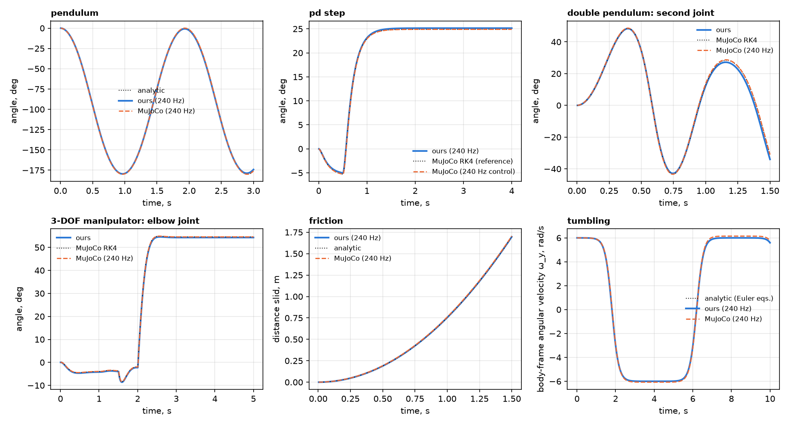

# Проверка точности: аналитика и MuJoCo

«У нас своя физика» — это аргумент только тогда, когда она сверена с эталоном. Скрипт [`python/validation/compare_mujoco.py`](../python/validation/compare_mujoco.py) прогоняет шесть сценариев и сравнивает движок с замкнутыми решениями и с [MuJoCo](https://mujoco.org).

```sh
pip install mujoco matplotlib
python python/validation/compare_mujoco.py --plot docs/images/validation.png
python -m pytest python/tests/test_validation.py   # то же как тест: падает, если допуск превышен
```

<p align="center"></p>

## Как сравнивается

Для каждого сценария три кривые:

- **эталон** — аналитическое решение либо MuJoCo с интегратором RK4 и шагом 1/2400–1/4800 с;
- **наш движок** с настройками по умолчанию (шаг 1/240 с, 4 подшага);
- **MuJoCo (240 Гц)** — его интегратор по умолчанию (Euler) с шагом 1/240 с, чтобы оба движка получили одинаковый «бюджет».

PD-регуляторы вычисляются с частотой 240 Гц, момент удерживается между вычислениями — так работает и наш движок. Поэтому сравнивается интегрирование, решение связей и контакты, а не различия в организации контура управления. Геометрия и массы идентичны (MJCF строится по тем же размерам и массам; тензоры инерции MuJoCo считает сам по боксам).

## Результаты

| Сценарий | Эталон | Ошибка нашего движка | Ошибка MuJoCo (240 Гц) |
|---|---|---:|---:|
| Свободный маятник, 3 с | аналитика (ОДУ) | 1,89° | 0,65° |
| PD-сустав: удержание и ступенька 30°, 4 с | MuJoCo RK4 | 0,26° | 0,44° |
| Двойной маятник, первые 0,8 с (звено 1 / звено 2) | MuJoCo RK4 | 0,09° / 0,53° | 0,95° / 0,60° |
| Манипулятор 3-DOF, PD на всех суставах, ступеньки 50/35/55° (макс. по суставам) | MuJoCo RK4 | 0,31° / 0,36° / 0,92° | 0,69° / 0,35° / 1,13° |
| Манипулятор: положение инструмента, макс. | MuJoCo RK4 | 10,1 мм | 16,3 мм |
| Скольжение с трением Кулона (μ = 0,4, уклон 30°), 1,7 м | аналитика | 1,6 мм | 10,7 мм |
| Тело без моментов, вращение вокруг средней оси: ω(t), 10 с | уравнения Эйлера | 4·10⁻⁵ рад/с | 0,17 рад/с |
| То же: дрейф энергии за 10 с | — | 4·10⁻¹⁰ % | 5 % |

Что из этого следует:

- **Гироскопика и сохранение энергии** — самая сильная сторона движка: опрокидывание тела воспроизводится почти точно, энергия и момент импульса сохраняются до 10⁻¹⁰ %.
- **Трение** считается точнее (ошибка пути в 6 раз меньше), на PD-контурах и в связках движок не хуже MuJoCo на том же шаге.
- **Простой маятник** — единственный сценарий, где MuJoCo точнее (0,65° против 1,89°). Причина понятна: интегрирование с подшагами — первого порядка, ошибка обратно пропорциональна их числу:

  | подшагов | 1 | 4 (по умолчанию) | 8 | 16 |
  |---|---:|---:|---:|---:|
  | макс. ошибка маятника | 7,30° | 1,88° | 0,95° | 0,47° |

  Если важна точность свободного движения, увеличьте `world.substeps`.

## Чего это не доказывает

- Сравнение не говорит, что движок «лучше MuJoCo»: взяты его настройки по умолчанию на крупном шаге, и контактная часть проверена только одним сценарием (трение). Сложные контакты (штабели, кучи) здесь не сравниваются — они покрыты собственными тестами движка.
- Ни один из сценариев не использует выпуклые оболочки, CCD и датчики.
- Эталон RK4 — тоже численное решение; для маятника, трения и тела без моментов использованы аналитические решения.
